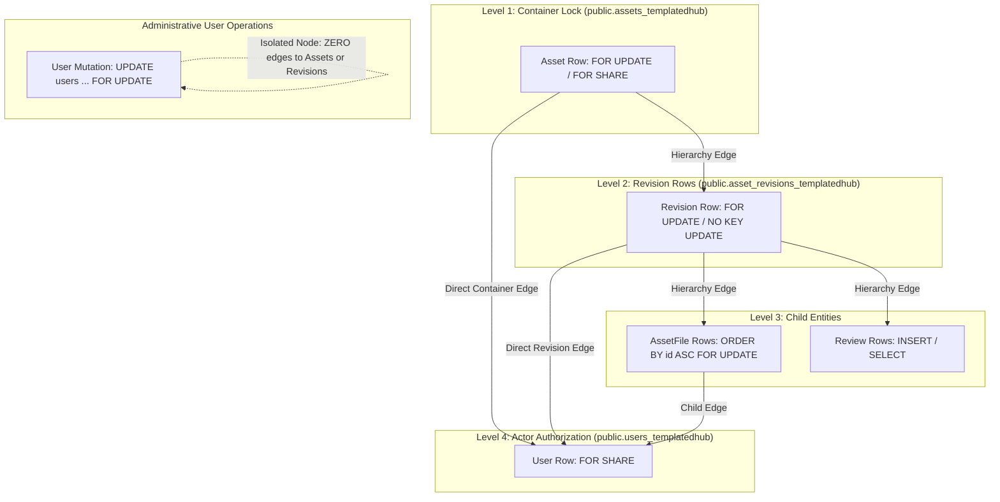

# sBLOOM Database Schema & Integrity Specification (Supabase _templatedhub Edition)

## 1. Executive Summary & Design Scope
This document specifies the authoritative PostgreSQL database architecture, custom trigger functions, role privilege boundaries, lock hierarchies, and compliance protocols for the **sBLOOM Template & Content Hub**, targeted for **Supabase Managed PostgreSQL**.

Key architectural guarantees include:
1. **Physical Table Naming Convention (`_templatedhub`)**: All 11 application domain tables in schema `public` carry the authoritative `_templatedhub` suffix to prevent collisions and isolate the Template & Content Hub domain within shared Supabase databases. Prisma maps models cleanly using `@@map("<name>_templatedhub")` while keeping application TypeScript models readable.
2. **Naming Convention Boundaries**:
   - **Application Domain Tables**: Exactly 11 tables suffixed with `_templatedhub` (`users_templatedhub`, `assets_templatedhub`, etc.).
   - **Database Enums, Triggers, Functions**: Named cleanly by domain function (e.g. `UserRole`, `AssetStatus`, `trg_verify_review_linkage`, `submit_draft_revision`), avoiding indiscriminate suffix pollution.
   - **PostgreSQL System & Supabase Schemas**: `auth`, `storage`, `graphql`, `realtime`, and `extensions` remain unpolluted and managed by Supabase.
3. **Application Identity & Supabase Auth Mapping**: The primary key `users_templatedhub.id` (`UUID`) maps 1:1 with Supabase Auth `auth.users.id`. Profile metadata, role (`ADMIN | CONTRIBUTOR`), and activity status are managed within `users_templatedhub`.
4. **Supabase Dual Connection Architecture**:
   - `DIRECT_URL` (Port 5432): Dedicated direct session connection used exclusively for Prisma migrations, DDL execution, and advisory locks.
   - `DATABASE_URL` (Port 6543): Transaction connection pooler (PgBouncer/Supavisor) used by Prisma Client for runtime application queries.
5. **Air-Tight Review Linkage Enforcement (`deciding_review_id`)**: Strict 1-to-1 unique pointer `asset_revisions_templatedhub.deciding_review_id` backstopped by PostgreSQL deferred constraint trigger `trg_verify_review_linkage`.
6. **Explicit Database Authorization Boundary & Least-Privilege Grants**: Column-level privilege restrictions and controlled stored procedures (`submit_draft_revision`, `record_review_decision`, `publish_asset_revision`).
7. **Provable Deadlock-Free Lock Hierarchy**: Top-down lock acquisition ($\text{Asset Container} \rightarrow \text{AssetRevision} \rightarrow \text{Child Entities}$).
8. **Anonymized Slug-Free Compliance Audits**: Creative slugs omitted from `audit_events_templatedhub`.
9. **Transactional Outbox & Storage Reliability**: `storage_deletion_jobs_templatedhub` with state-machine trigger and DLQ manual recovery restricted to administrators.

### 1.1 Physical Table-Name Mapping Matrix

| Prisma TypeScript Model | Physical PostgreSQL Table | Purpose & Notes |
| :--- | :--- | :--- |
| `User` | `users_templatedhub` | User profile, role, and active status; maps 1:1 to `auth.users.id`. |
| `AssetType` | `asset_types_templatedhub` | Template category/type registry and JSON schema definitions. |
| `Asset` | `assets_templatedhub` | Top-level template container, slug, status, and published pointer. |
| `AssetRevision` | `asset_revisions_templatedhub` | Monotonic revision records, freeze status, and review linkage. |
| `AssetFile` | `asset_files_templatedhub` | Storage locator references attached to draft/frozen revisions. |
| `Review` | `reviews_templatedhub` | Formal editorial peer-review decisions and comments. |
| `AuditEvent` | `audit_events_templatedhub` | Append-only audit trail; creative slugs omitted for compliance. |
| `Collection` | `collections_templatedhub` | User-curated template collections and visibility flags. |
| `CollectionAsset` | `collection_assets_templatedhub` | Join table establishing asset membership and position in collections. |
| `AssetUsage` | `asset_usages_templatedhub` | Telemetry tracking for template view, download, preview, remix. |
| `StorageDeletionJob` | `storage_deletion_jobs_templatedhub` | Transactional outbox for decoupled physical storage deletions. |

---

## 2. Database Privilege Boundaries & Role Hardening

### 2.1 Role Architecture & Ownership Hierarchy
The PostgreSQL database environment defines three non-overlapping roles to guarantee strict privilege separation:

```
                    ┌─────────────────────────────────┐
                    │          sbloom_owner           │
                    │   (DDL Owner / Non-Login Role)   │
                    └─────────────────────────────────┘
                                     │
                 Owns all Tables, Functions, and Triggers
                                     │
           ┌─────────────────────────┴─────────────────────────┐
           ▼                                                   ▼
┌─────────────────────────────────┐         ┌─────────────────────────────────┐
│          sbloom_admin           │         │           sbloom_app            │
│  (Privileged Maintenance Role)  │         │   (Runtime Application Service) │
│ - Separate connection pool      │         │ - Used by Express backend API   │
│ - GRANTED: admin_purge_asset    │         │ - GRANTED: Content DML only     │
│ - Restricted network origin     │         │ - REVOKED: Direct status UPDATE │
│ - NO membership in sbloom_owner │         │ - GRANTED: Controlled functions │
└─────────────────────────────────┘         └─────────────────────────────────┘
```

### 2.2 Proof of Privilege Isolation: Why `sbloom_app` Cannot Bypass Protections

#### 1. Cannot Impersonate `sbloom_owner` (`SET ROLE` Protection)
- In PostgreSQL, executing `SET ROLE <role>` strictly requires that the current session role has been granted explicit membership in that target role (`GRANT sbloom_owner TO sbloom_app`).
- Schema provisioning explicitly revokes default grants:
  ```sql
  REVOKE ALL PRIVILEGES ON SCHEMA public FROM PUBLIC;
  REVOKE CREATE ON SCHEMA public FROM PUBLIC;
  -- Neither sbloom_app nor sbloom_admin is granted membership in sbloom_owner
  -- sbloom_app is created with NOINHERIT
  ```
- *Proof*: If an attacker executes `SET ROLE sbloom_owner;` over the `sbloom_app` connection, PostgreSQL immediately rejects the statement:
  `ERROR: 42501: permission denied to set role "sbloom_owner"`.

#### 2. Cannot Alter Tables, Disable Triggers, or Drop Functions
- In PostgreSQL, altering a table (`ALTER TABLE ... DISABLE TRIGGER`), dropping a trigger (`DROP TRIGGER`), or modifying a function (`CREATE OR REPLACE FUNCTION`) **strictly requires ownership of the object or superuser status**.
- All tables, triggers, and functions are exclusively owned by `sbloom_owner`.
- `sbloom_app` is granted only data manipulation privileges on public tables.
- *Proof*: If `sbloom_app` executes `ALTER TABLE public.asset_files_templatedhub DISABLE TRIGGER trg_asset_file_immutability;`, PostgreSQL rejects the statement:
  `ERROR: 42501: must be owner of table asset_files`.

#### 3. Cannot Shadow Objects or Hijack Search Paths
- All triggers and procedures explicitly configure `SET search_path = pg_catalog, public, pg_temp`.
- Schema creation privileges on `public` are revoked: `REVOKE CREATE ON SCHEMA public FROM PUBLIC, sbloom_app, sbloom_admin;`.
- Tables inside procedures are explicitly qualified with `public.`.
- *Proof*: `sbloom_app` cannot create a shadowing function or table in `public` or alter the resolution order of `pg_catalog`.

#### 4. Cannot Forge the Purge Bypass Exception
- The triggers `trg_asset_file_immutability` and `trg_asset_revision_delete` require **BOTH**:
  `current_setting('sbloom.admin_purge_active', true) = 'true'` **AND** `CURRENT_USER = 'sbloom_owner'`.
- *Proof*: If an attacker or compromised application thread executes `SET sbloom.admin_purge_active = 'true'; DELETE FROM public.asset_files_templatedhub;`:
  The trigger evaluates `CURRENT_USER`. Because the session is connected as `sbloom_app`, `CURRENT_USER` is `'sbloom_app'`.
  The condition `CURRENT_USER = 'sbloom_owner'` evaluates to `FALSE`.
  The trigger raises `ERROR: Security violation: Unauthorized purge bypass attempt by role sbloom_app`.

#### 5. Caller Validation in `admin_purge_asset`
- `admin_purge_asset` is created as `SECURITY DEFINER` owned by `sbloom_owner`.
- Execution is revoked from `PUBLIC` and `sbloom_app`, and granted exclusively to `sbloom_admin`.
- The procedure verifies caller authenticity and records both database and application identities:
  ```sql
  IF SESSION_USER != 'sbloom_admin' AND CURRENT_USER != 'sbloom_owner' THEN
    RAISE EXCEPTION 'Security violation: Only sbloom_admin can execute admin_purge_asset (caller: %)', SESSION_USER;
  END IF;

  SELECT role, is_active INTO v_admin_role, v_admin_active
    FROM public.users_templatedhub
   WHERE id = p_admin_user_id;

  IF v_admin_role IS NULL OR v_admin_role != 'ADMIN' OR v_admin_active IS NOT TRUE THEN
    RAISE EXCEPTION 'Access denied: Actor % is not an active system administrator', p_admin_user_id;
  END IF;
  ```
- The audit record in `public.audit_events_templatedhub` logs `actor_id = p_admin_user_id`, `db_caller = SESSION_USER`, and network origin `inet_client_addr()`.

---

## 3. Workflow Authorization & Review Linkage Integrity

### 3.1 The Three Trust Tiers

| Tier | Domain | Enforcing Layer | Technical Guarantees |
|---|---|---|---|
| **Tier A** | **Structural Integrity & Lifecycle State Machine** | **PostgreSQL Triggers & Constraints** | Physical validation of graph transitions (`CASE OLD.status`), content freezing upon submission, identity/provenance immutability, foreign-key consistency, and non-reusable revision numbers. |
| **Tier B** | **Review Linkage & Editorial Provenance** | **PostgreSQL Deferred Constraint Triggers** | Every decision status (`APPROVED`, `CHANGES_REQUESTED`, `REJECTED`) strictly requires an atomic, unique, matching `Review` record linked via `AssetRevision.deciding_review_id`. Database engine physically blocks author self-review (`reviewer_id != created_by_id`) and verifies reviewer is an active Admin. |
| **Tier C** | **Actor Authentication & Session Authorization** | **Application Service Boundary (Express API)** | Verification of RS256 JWT signatures from BFF, resolution of HTTP caller identity to user ID, and enforcement of user role permissions. |

---

### 3.2 The Trust Boundary: What the Database Can vs. Cannot Verify
- **What PostgreSQL Independently Guarantees**:
  1. A revision can NEVER transition to `APPROVED` or `CHANGES_REQUESTED` without a valid `Review` record.
  2. The review decision MUST match the revision's new status.
  3. The reviewer ID on the review record CANNOT be the author of the revision (`reviewer_id != created_by_id`).
  4. The reviewer ID on the review record MUST belong to an active administrator account in `public.users_templatedhub` (`role = 'ADMIN' AND is_active = true`).
  5. The review cannot be stolen, reused, or shared across multiple revisions (`deciding_review_id` is unique on `asset_revisions`).
  6. In `delete_draft_revision`: The database validates that `p_actor_id` corresponds to an active account (`is_active = true`), and if `p_actor_id != created_by_id`, enforces that `role = 'ADMIN'`. Furthermore, deletion is physically blocked if the revision is not in `DRAFT` status under the established row lock.
  7. In `archive_asset` and `unarchive_asset`: The database validates that `p_actor_id` is an active administrator.
  8. In `admin_purge_asset`: The database validates both the database session role (`SESSION_USER = 'sbloom_admin'`) and the application administrator record (`role = 'ADMIN' AND is_active = true`).
- **The Inescapable Limitation of Shared Connection Pools**:
  - The Express backend connects to PostgreSQL as a single shared database role: `sbloom_app`.
  - PostgreSQL does not inspect HTTP headers, session cookies, or JWT signatures.
  - If `sbloom_app` is compromised by SQL injection, an attacker could supply an existing Admin's UUID as the `reviewer_id` or `p_actor_id`.
  - While PostgreSQL guarantees that the supplied actor is an active Admin, and forces an immutable review or audit row to be written, **only the Express application server can cryptographically prove that the human making the request is that Admin**.
  - Documenting this distinction accurately reflects robust security architecture without inventing unprovable database claims.
- **Storage Bucket Configuration & Trusted Resolution**:
  - Attached asset files in `public.asset_files_templatedhub` store relative storage keys (`storage_key`).
  - Physical object storage deletion jobs in `public.storage_deletion_jobs_templatedhub` resolve the target bucket via the trusted function `public.resolve_storage_bucket()`.
  - The system establishes `'sBLOOM_templateshub'` as the immutable canonical production bucket. (Note: Database namespace remains `*_templatedhub`, while Storage bucket is `sBLOOM_templateshub`).
  - Setting `sbloom.storage_bucket` is subject to strict allowlist validation covering approved environments (`sBLOOM_templateshub`, `sBLOOM_templateshub-staging`, `sBLOOM_templateshub-dev`, `sBLOOM_templateshub-test`, `sBLOOM_templateshub-isolated-test`). Unrestricted callers (`sbloom_app`, `PUBLIC`) cannot select noncanonical buckets; noncanonical bucket selection is strictly restricted to trusted administrative sessions (`SESSION_USER IN ('sbloom_owner', 'sbloom_admin')`).
  - The asynchronous storage cleanup worker reads `bucket_name` directly from each outbox job record and never silently substitutes another destination.

---

### 3.3 Effective Privilege Architecture & Column-Level Enforcement

#### 1. PostgreSQL Privilege Semantics & The Table-Level Privilege Fallacy
In PostgreSQL, privileges are **strictly cumulative**:
- If a role holds `UPDATE` on a table as a whole (e.g. via `GRANT UPDATE ON table TO role`), executing `REVOKE UPDATE (column) ON table FROM role` has **zero effect**; the table-level privilege still permits updating every column.
- Similarly, table-level `INSERT` permits specifying arbitrary values for any column, bypassing column-level default assumptions.
- Therefore, to establish airtight column-level security:
  1. All table-level write privileges (`INSERT`, `UPDATE`, `DELETE`, `TRUNCATE`) must be revoked from `sbloom_app` and `PUBLIC`.
  2. Write privileges must be granted **exclusively on explicitly enumerated, non-sensitive columns**.

#### 2. Search-Path Semantics & Shadowing Mitigation
In PostgreSQL:
- If `pg_temp` is omitted from `search_path`, PostgreSQL **implicitly places `pg_temp` as the very first schema to search** (even before `pg_catalog`).
- Therefore, claiming that omitting `pg_temp` eliminates temporary object shadowing is mathematically false in PostgreSQL; it actually gives temporary objects the highest resolution priority!
- The sound defense is to explicitly specify `pg_temp` **at the very end of the search path**:
  ```sql
  SET search_path = pg_catalog, public, pg_temp;
  ```
  This ensures:
  1. `pg_catalog` built-ins and core operators resolve first.
  2. `public` objects resolve second.
  3. `pg_temp` is only evaluated if an object does not exist in `pg_catalog` or `public`.
  4. All relational references in `SECURITY DEFINER` functions are explicitly qualified (e.g. `public.assets_templatedhub`).
  5. Untrusted roles (`sbloom_app`, `sbloom_admin`, `PUBLIC`) have **zero `CREATE` privilege on schema `public`**, preventing the creation of shadow objects in `public`.

#### 3. Effective Privilege Matrix across Tables and Operations

| Table | Operation | Granted to `sbloom_app` | Prohibited / Restricted Columns | Failure Mechanism on Violation |
| :--- | :--- | :--- | :--- | :--- |
| `public.users_templatedhub` | `SELECT` | All columns | None | N/A |
| `public.users_templatedhub` | `UPDATE` | `(name, updated_at)` | `role`, `is_active`, `email`, `created_at` | `ERROR: permission denied for column role of relation users` |
| `public.users_templatedhub` | `INSERT` | Registration columns | `role` (defaults to `CONTRIBUTOR`), `is_active` | `ERROR: permission denied for column role of relation users` |
| `public.assets_templatedhub` | `SELECT` | All columns | None | N/A |
| `public.assets_templatedhub` | `INSERT` | `(id, slug, legacy_id, import_source, type_id, creator_id, is_featured)` | `status` (defaults to `DRAFT`), `current_published_revision_id`, `last_revision_number` (defaults to `0`), `archived_at` | `ERROR: permission denied for column [status|last_revision_number] of relation assets` |
| `public.assets_templatedhub` | `UPDATE` | `(slug, type_id, is_featured)` | `status`, `current_published_revision_id`, `archived_at`, `last_revision_number` | `ERROR: permission denied for column [status|archived_at|last_revision_number] of relation assets` |
| `public.asset_revisions_templatedhub` | `SELECT` | All columns | None | N/A |
| `public.asset_revisions_templatedhub` | `INSERT` | **NONE** (Revoked) | Entire table | `ERROR: permission denied for relation asset_revisions`. Revisions can ONLY be created via `allocate_next_revision`! |
| `public.asset_revisions_templatedhub` | `UPDATE` | `(title, description, metadata, schema_version)` | `status`, `deciding_review_id`, `published_at`, `created_by_id`, `revision_number`, `asset_id`, `id` | `ERROR: permission denied for column status of relation asset_revisions` |
| `public.asset_revisions_templatedhub` | `DELETE` | **NONE** (Revoked) | Entire table | `ERROR: permission denied for relation asset_revisions`. Draft deletion strictly routed via `delete_draft_revision`! |
| `public.asset_files_templatedhub` | `SELECT, INSERT, UPDATE, DELETE` | Table-level | Guarded by `trg_asset_file_immutability` | Trigger aborts file changes on frozen revisions (`status != 'DRAFT'`) |
| `public.reviews_templatedhub` | `SELECT` | All columns | None | N/A |
| `public.reviews_templatedhub` | `INSERT, UPDATE, DELETE` | **NONE** (Revoked) | Entire table | `ERROR: permission denied for relation reviews`. Reviews can only be written via `record_review_decision`! |
| `public.audit_events_templatedhub` | `SELECT, INSERT` | Table-level | `UPDATE`, `DELETE` revoked | Append-only; trigger `trg_audit_events_immutable` aborts tampering |
| `public.storage_deletion_jobs_templatedhub`| `SELECT, UPDATE` | `(status, attempts, last_error, processed_at)` | Direct `INSERT`, `DELETE` revoked | Worker can only update execution status |

#### 4. Exact SQL DDL for Role & Column Privileges
```sql
-- 1. REVOKE DEFAULT & TABLE-LEVEL PRIVILEGES
REVOKE ALL ON SCHEMA public FROM PUBLIC;
REVOKE ALL ON ALL TABLES IN SCHEMA public FROM PUBLIC;
REVOKE ALL ON ALL FUNCTIONS IN SCHEMA public FROM PUBLIC;
ALTER DEFAULT PRIVILEGES IN SCHEMA public REVOKE EXECUTE ON FUNCTIONS FROM PUBLIC;

-- 2. SCHEMA PRIVILEGES
GRANT USAGE ON SCHEMA public TO sbloom_app, sbloom_admin;
GRANT ALL ON SCHEMA public TO sbloom_owner;
REVOKE CREATE ON SCHEMA public FROM PUBLIC, sbloom_app, sbloom_admin;

-- 3. ASSET_REVISIONS PRIVILEGES (ZERO DIRECT INSERT OR DELETE; CONTROLLED PROCEDURES ONLY)
REVOKE ALL ON public.asset_revisions_templatedhub FROM sbloom_app;
REVOKE INSERT, DELETE ON public.asset_revisions_templatedhub FROM PUBLIC, sbloom_app, sbloom_admin;
GRANT SELECT ON public.asset_revisions_templatedhub TO sbloom_app;
GRANT UPDATE (
  title, description, metadata, schema_version
) ON public.asset_revisions_templatedhub TO sbloom_app;

-- 4. REVIEWS TABLE RESTRICTIONS (ZERO DIRECT WRITE BY APPLICATION)
REVOKE ALL ON public.reviews_templatedhub FROM sbloom_app;
GRANT SELECT ON public.reviews_templatedhub TO sbloom_app;

-- 5. ASSETS COLUMN PRIVILEGES (COUNTER & ARCHIVED_AT STRICTLY RESTRICTED)
REVOKE ALL ON public.assets_templatedhub FROM sbloom_app;
GRANT SELECT ON public.assets_templatedhub TO sbloom_app;
GRANT INSERT (
  id, slug, legacy_id, import_source, type_id, creator_id, is_featured
) ON public.assets_templatedhub TO sbloom_app;
GRANT UPDATE (
  slug, type_id, is_featured
) ON public.assets_templatedhub TO sbloom_app;

-- 6. USERS PRIVILEGES
REVOKE ALL ON public.users_templatedhub FROM sbloom_app;
GRANT SELECT ON public.users_templatedhub TO sbloom_app;
GRANT UPDATE (name, updated_at) ON public.users_templatedhub TO sbloom_app;

-- 7. AUDIT_EVENTS APPEND-ONLY PRIVILEGES
REVOKE ALL ON public.audit_events_templatedhub FROM sbloom_app;
GRANT SELECT, INSERT ON public.audit_events_templatedhub TO sbloom_app;

-- 8. ASSET_FILES PRIVILEGES
REVOKE ALL ON public.asset_files_templatedhub FROM sbloom_app;
GRANT SELECT, INSERT, UPDATE, DELETE ON public.asset_files_templatedhub TO sbloom_app;

-- 9. STORAGE DELETION JOBS PRIVILEGES
REVOKE ALL ON public.storage_deletion_jobs_templatedhub FROM sbloom_app;
GRANT SELECT ON public.storage_deletion_jobs_templatedhub TO sbloom_app;
GRANT UPDATE (status, attempts, last_error, processed_at) ON public.storage_deletion_jobs_templatedhub TO sbloom_app;

-- 10. WORKFLOW STORED PROCEDURES EXECUTE GRANTS
GRANT EXECUTE ON FUNCTION public.submit_draft_revision(UUID) TO sbloom_app;
GRANT EXECUTE ON FUNCTION public.record_review_decision(UUID, UUID, "ReviewDecision", TEXT) TO sbloom_app;
GRANT EXECUTE ON FUNCTION public.publish_asset_revision(UUID, UUID) TO sbloom_app;
GRANT EXECUTE ON FUNCTION public.allocate_next_revision(UUID, TEXT, TEXT, JSONB, INT, UUID) TO sbloom_app;
GRANT EXECUTE ON FUNCTION public.delete_draft_revision(UUID, UUID) TO sbloom_app;
GRANT EXECUTE ON FUNCTION public.archive_asset(UUID, UUID) TO sbloom_app;
GRANT EXECUTE ON FUNCTION public.unarchive_asset(UUID, UUID) TO sbloom_app;
GRANT EXECUTE ON FUNCTION public.resolve_storage_bucket() TO sbloom_app, sbloom_admin;
REVOKE ALL ON FUNCTION public.resolve_storage_bucket() FROM PUBLIC;

-- 11. PRIVILEGED PURGE RESTRICTION (OWNER & ADMIN ONLY)
REVOKE ALL ON FUNCTION public.admin_purge_asset(UUID, UUID, TEXT) FROM PUBLIC, sbloom_app;
GRANT EXECUTE ON FUNCTION public.admin_purge_asset(UUID, UUID, TEXT) TO sbloom_admin;
```

#### 5. Prevention of Alternate Write Paths (INSERT, UPSERT)
- **Direct INSERT Bypass**: Direct `INSERT` into `public.asset_revisions_templatedhub` is revoked from `sbloom_app` and `PUBLIC`. Any direct attempt by `sbloom_app` to run `INSERT INTO public.asset_revisions_templatedhub ...` is rejected at the SQL parser level with `ERROR: permission denied for relation asset_revisions`.
- **UPSERT Bypass**: Attempting `INSERT INTO asset_revisions (...) ON CONFLICT (asset_id, revision_number) DO UPDATE SET ...` is rejected at the parser level due to lack of `INSERT` privilege on `asset_revisions`.
- **Defense-in-Depth Trigger (`trg_asset_revision_insert_defaults`)**:
  Even if executed under an elevated role (e.g. initial migrations or data seeds by `sbloom_owner`), any revision inserted must strictly conform to lifecycle defaults and must match the parent asset's `last_revision_number`:
  ```sql
  CREATE OR REPLACE FUNCTION public.process_asset_revision_insert_defaults()
  RETURNS TRIGGER 
  LANGUAGE plpgsql
  SECURITY DEFINER
  SET search_path = pg_catalog, public, pg_temp
  AS $$
  DECLARE
    v_asset_last_rev int;
  BEGIN
    IF NEW.status IS DISTINCT FROM 'DRAFT'::"RevisionStatus" THEN
      RAISE EXCEPTION 'Security violation: New revisions must be created in DRAFT status (attempted: %)', NEW.status;
    END IF;
    IF NEW.deciding_review_id IS NOT NULL THEN
      RAISE EXCEPTION 'Security violation: New revisions cannot specify deciding_review_id at creation (must be NULL)';
    END IF;

    -- Verify that revision_number exactly matches the parent asset's last_revision_number
    SELECT last_revision_number INTO v_asset_last_rev
      FROM public.assets_templatedhub
     WHERE id = NEW.asset_id;

    IF v_asset_last_rev IS NULL THEN
      RAISE EXCEPTION 'Security violation: Parent asset % does not exist', NEW.asset_id;
    END IF;

    IF NEW.revision_number != v_asset_last_rev THEN
      RAISE EXCEPTION 'Revision allocation mismatch: new revision_number (%) does not match asset last_revision_number (%)',
        NEW.revision_number, v_asset_last_rev;
    END IF;

    RETURN NEW;
  END;
  $$;

  CREATE TRIGGER trg_asset_revision_insert_defaults
  BEFORE INSERT ON public.asset_revisions_templatedhub
  FOR EACH ROW
  EXECUTE FUNCTION public.process_asset_revision_insert_defaults();
  ```

---

### 3.4 Workflow Actor-Identity Trust Model & Evaluation

#### 1. The Threat of SQL Injection under `sbloom_app`
Because `sbloom_app` possesses `EXECUTE` on `record_review_decision(p_revision_id, p_reviewer_id, p_decision, p_comments)` and `delete_draft_revision(p_revision_id, p_actor_id)`:
- An attacker achieving raw SQL injection could query:
  `SELECT id FROM public.users_templatedhub WHERE role = 'ADMIN' AND is_active = true LIMIT 1;`
- And invoke:
  `SELECT public.record_review_decision(<target_rev>, <harvested_admin_id>, 'APPROVED', 'approved');`
  or
  `SELECT public.delete_draft_revision(<target_rev>, <harvested_author_or_admin_id>);`
- PostgreSQL validates that the supplied UUID belongs to an active user in `public.users_templatedhub` with the necessary privileges (Admin for review; revision author or Admin for draft deletion). However, **PostgreSQL cannot independently verify that the human user at the keyboard was actually that actor**.

#### 2. Evaluation of Architectural Approaches

| Approach | Architecture Description | What It Protects Against | What It CANNOT Protect Against | Feasibility with Pooled DB |
| :--- | :--- | :--- | :--- | :--- |
| **Approach A: Role-Segregated Pools** | Separate database roles: `sbloom_app` (general API, no execute on review/deletion procedures) and `sbloom_privileged` (admin/review endpoints). | SQL injection in contributor/public endpoints cannot execute review transitions or draft deletions. | SQL injection within privileged endpoints running under `sbloom_privileged`. | **High**: Requires separate pool instances in Express. |
| **Approach B: Signed Actor Assertions** | Express backend signs an HMAC-SHA256 token `(actor_id, revision_id, action, exp, nonce)` using an internal server secret. Stored procedure verifies signature using `pgcrypto` and checks a nonce table. | SQL injection without server memory access cannot forge valid tokens for arbitrary admins. | Full server RCE where attacker reads the HMAC secret; replay if nonce table pruned. | **Moderate**: Adds cryptographic complexity, key custody, and nonce cleanup overhead. |
| **Approach C: Trusted Application Boundary (Selected Baseline)** | Express API is the authoritative authentication authority. Database acts as the relational and invariant enforcement authority. | Invalid state transitions, non-admin reviewers, author self-review, unlinked reviews, double-approvals, unauthorized draft deletions, and column tampering. | Arbitrary SQL execution under `sbloom_app` passing a harvested active admin ID. | **Native**: Standard connection pooling architecture. |

#### 3. Formal Trust Boundary Definition
The sBLOOM architecture adopts **Approach C (Trusted Application Boundary)** with strict **Defense-in-Depth Relational Enforcement**:
1. **The Application Tier Is the Authoritative Identity Boundary**: The Express API authenticates human users via cryptographic RS256 JWT session tokens and verifies role and author eligibility (`requireRole('ADMIN')` or matching authenticated user ID) before invoking database procedures.
2. **The Database Tier Is the Invariant & Integrity Boundary**: PostgreSQL enforces state machine validity, non-self-review, active admin/author eligibility of the referenced actor, and atomic review linkage.
3. **Explicitly Accepted Limitation**: The architecture deliberately trusts the Express process to assert human identity over the shared `sbloom_app` connection pool. We make **no claim** that the database can independently authenticate human end users if an attacker attains arbitrary SQL execution under `sbloom_app`.
4. **Storage Bucket Configuration & Trusted Resolution**: S3 object storage keys in `public.asset_files_templatedhub.storage_key` store keys relative to the configured storage bucket. Storage cleanup jobs enqueued into `public.storage_deletion_jobs_templatedhub` resolve the bucket name via the trusted function `public.resolve_storage_bucket()`. The system establishes `'sBLOOM_templateshub'` as the canonical production bucket. Unrestricted callers (`sbloom_app`) cannot select noncanonical buckets; bucket selection enforces an explicit allowlist of supported environments (`sBLOOM_templateshub`, `sBLOOM_templateshub-staging`, `sBLOOM_templateshub-dev`, `sBLOOM_templateshub-test`, `sBLOOM_templateshub-isolated-test`) and requires trusted administrative sessions (`SESSION_USER IN ('sbloom_owner', 'sbloom_admin')`). Empty, blank, or unapproved bucket names are strictly rejected. The storage worker faithfully deletes from the bucket recorded in each outbox job without destination substitution.

---

## 4. PostgreSQL Trigger & Function Specification

### 4.1 Review Linkage Constraint Trigger (`trg_verify_review_linkage`)
Enforces atomic, 1-to-1 linkage across all editorial decision statuses (`APPROVED`, `CHANGES_REQUESTED`, `REJECTED`).

```sql
CREATE OR REPLACE FUNCTION public.check_revision_review_linkage()
RETURNS TRIGGER 
SECURITY DEFINER
SET search_path = pg_catalog, public, pg_temp
AS $$
DECLARE
  v_review public.reviews_templatedhub%ROWTYPE;
  v_reviewer_role text;
  v_reviewer_active boolean;
BEGIN
  -- 1. If transitioning into any editorial decision status:
  IF NEW.status IN ('APPROVED', 'CHANGES_REQUESTED', 'REJECTED') AND 
     OLD.status IN ('SUBMITTED', 'CHANGES_REQUESTED', 'APPROVED') THEN
    
    -- A. Must provide an explicit deciding_review_id
    IF NEW.deciding_review_id IS NULL THEN
      RAISE EXCEPTION 'Workflow integrity violation: Transitioning revision % from % to % requires a non-NULL deciding_review_id',
        NEW.id, OLD.status, NEW.status;
    END IF;

    -- B. Fetch the referenced review row
    SELECT * INTO v_review
      FROM public.reviews_templatedhub
     WHERE id = NEW.deciding_review_id;

    IF v_review.id IS NULL THEN
      RAISE EXCEPTION 'Workflow integrity violation: Deciding review % does not exist', NEW.deciding_review_id;
    END IF;

    -- C. Strict 1-to-1 Target Match
    IF v_review.revision_id != NEW.id THEN
      RAISE EXCEPTION 'Workflow integrity violation: Deciding review % targets revision % but was attached to revision %',
        v_review.id, v_review.revision_id, NEW.id;
    END IF;

    IF v_review.asset_id != NEW.asset_id THEN
      RAISE EXCEPTION 'Workflow integrity violation: Deciding review % targets asset % but revision belongs to asset %',
        v_review.id, v_review.asset_id, NEW.asset_id;
    END IF;

    -- D. Lifecycle Status & Decision Match
    IF v_review.previous_status != OLD.status::text THEN
      RAISE EXCEPTION 'Workflow integrity violation: Review previous_status (%) does not match revision previous status (%)',
        v_review.previous_status, OLD.status;
    END IF;

    IF v_review.new_status != NEW.status::text THEN
      RAISE EXCEPTION 'Workflow integrity violation: Review new_status (%) does not match revision target status (%)',
        v_review.new_status, NEW.status;
    END IF;

    IF NEW.status = 'APPROVED' AND v_review.decision != 'APPROVED' THEN
      RAISE EXCEPTION 'Workflow integrity violation: Revision status is APPROVED but review decision is %', v_review.decision;
    END IF;

    IF NEW.status = 'CHANGES_REQUESTED' AND v_review.decision != 'CHANGES_REQUESTED' THEN
      RAISE EXCEPTION 'Workflow integrity violation: Revision status is CHANGES_REQUESTED but review decision is %', v_review.decision;
    END IF;

    IF NEW.status = 'REJECTED' AND v_review.decision != 'REJECTED' THEN
      RAISE EXCEPTION 'Workflow integrity violation: Revision status is REJECTED but review decision is %', v_review.decision;
    END IF;

    -- E. Absolute Non-Self-Review Enforced by Database
    IF v_review.reviewer_id = NEW.created_by_id THEN
      RAISE EXCEPTION 'Peer-review integrity violation: Author % cannot review or decide their own revision %',
        NEW.created_by_id, NEW.id;
    END IF;

    -- F. Reviewer Eligibility Enforced by Database
    SELECT role, is_active INTO v_reviewer_role, v_reviewer_active
      FROM public.users_templatedhub
     WHERE id = v_review.reviewer_id;

    IF v_reviewer_role IS NULL OR v_reviewer_role != 'ADMIN' OR v_reviewer_active IS NOT TRUE THEN
      RAISE EXCEPTION 'Reviewer eligibility violation: User % is not an active system administrator (role: %, is_active: %)',
        v_review.reviewer_id, v_reviewer_role, v_reviewer_active;
    END IF;
  ELSE
    -- If not transitioning into a decision status (e.g. DRAFT -> SUBMITTED):
    IF OLD.status = 'DRAFT' AND NEW.status = 'SUBMITTED' THEN
      IF NEW.deciding_review_id IS NOT NULL THEN
        RAISE EXCEPTION 'Workflow integrity violation: Unreviewed revision % cannot have a deciding_review_id', NEW.id;
      END IF;
    END IF;
  END IF;

  RETURN NEW;
END;
$$ LANGUAGE plpgsql;

CREATE CONSTRAINT TRIGGER trg_verify_review_linkage
AFTER UPDATE OF status, deciding_review_id ON public.asset_revisions_templatedhub
DEFERRABLE INITIALLY DEFERRED
FOR EACH ROW
EXECUTE FUNCTION public.check_revision_review_linkage();
```

---

### 4.2 Controlled Workflow Procedures

#### 1. `record_review_decision`
Executes an atomic, lock-ordered review decision covering `APPROVED`, `CHANGES_REQUESTED`, and `REJECTED`:

```sql
CREATE OR REPLACE FUNCTION public.record_review_decision(
  p_revision_id UUID,
  p_reviewer_id UUID,
  p_decision "ReviewDecision",
  p_comments TEXT
)
RETURNS JSONB
LANGUAGE plpgsql
SECURITY DEFINER
SET search_path = pg_catalog, public, pg_temp
AS $$
DECLARE
  v_asset_id uuid;
  v_current_status text;
  v_author_id uuid;
  v_reviewer_role text;
  v_reviewer_active boolean;
  v_new_status "RevisionStatus";
  v_review_id uuid;
BEGIN
  -- 1. DISCOVER PARENT ASSET ID
  SELECT ar.asset_id INTO v_asset_id
    FROM public.asset_revisions_templatedhub ar
   WHERE ar.id = p_revision_id;

  IF v_asset_id IS NULL THEN
    RAISE EXCEPTION 'AssetRevision % does not exist', p_revision_id;
  END IF;

  -- 2. LEVEL 1 CONTAINER LOCK
  PERFORM 1 FROM public.assets_templatedhub WHERE id = v_asset_id FOR SHARE;
  IF NOT FOUND THEN
    RAISE EXCEPTION 'Parent asset % does not exist or was concurrently removed', v_asset_id;
  END IF;

  -- 3. LEVEL 2 REVISION ROW LOCK & READ CURRENT STATE ATOMICALLY
  SELECT ar.status, ar.created_by_id 
    INTO v_current_status, v_author_id
    FROM public.asset_revisions_templatedhub ar
   WHERE ar.id = p_revision_id AND ar.asset_id = v_asset_id
     FOR UPDATE;

  IF NOT FOUND THEN
    RAISE EXCEPTION 'AssetRevision % does not exist or was concurrently removed', p_revision_id;
  END IF;

  IF v_current_status != 'SUBMITTED' THEN
    RAISE EXCEPTION 'Cannot record review decision on revision % in status % (must be SUBMITTED)', 
      p_revision_id, v_current_status;
  END IF;

  -- 4. LEVEL 4 REVIEWER ELIGIBILITY & PEER REVIEW CHECK (FOR SHARE LOCK)
  IF p_reviewer_id = v_author_id THEN
    RAISE EXCEPTION 'Peer-review integrity violation: Author % cannot review their own revision %', 
      v_author_id, p_revision_id;
  END IF;

  SELECT role, is_active INTO v_reviewer_role, v_reviewer_active
    FROM public.users_templatedhub
   WHERE id = p_reviewer_id
     FOR SHARE;

  IF NOT FOUND OR v_reviewer_role IS NULL OR v_reviewer_role != 'ADMIN' OR v_reviewer_active IS NOT TRUE THEN
    RAISE EXCEPTION 'Reviewer eligibility violation: User % is not an active administrator', p_reviewer_id;
  END IF;

  -- 5. MAP DECISION TO TARGET STATUS
  IF p_decision = 'APPROVED' THEN
    v_new_status := 'APPROVED'::"RevisionStatus";
  ELSIF p_decision = 'CHANGES_REQUESTED' THEN
    v_new_status := 'CHANGES_REQUESTED'::"RevisionStatus";
  ELSIF p_decision = 'REJECTED' THEN
    v_new_status := 'REJECTED'::"RevisionStatus";
  ELSE
    RAISE EXCEPTION 'Unknown review decision: %', p_decision;
  END IF;

  -- 6. INSERT REVIEW RECORD (LEVEL 3)
  v_review_id := gen_random_uuid();

  INSERT INTO public.reviews_templatedhub (
    id, asset_id, revision_id, reviewer_id, previous_status, new_status, decision, comments, created_at
  ) VALUES (
    v_review_id, v_asset_id, p_revision_id, p_reviewer_id, v_current_status, v_new_status::text, p_decision, p_comments, NOW()
  );

  -- 7. UPDATE REVISION WITH ATOMIC LINKAGE (LEVEL 2)
  UPDATE public.asset_revisions_templatedhub
     SET status = v_new_status,
         deciding_review_id = v_review_id
   WHERE id = p_revision_id;

  RETURN jsonb_build_object(
    'review_id', v_review_id,
    'revision_id', p_revision_id,
    'asset_id', v_asset_id,
    'status', v_new_status,
    'decision', p_decision
  );
END;
$$;
```

#### 2. `submit_draft_revision`
```sql
CREATE OR REPLACE FUNCTION public.submit_draft_revision(
  p_revision_id UUID
)
RETURNS JSONB
LANGUAGE plpgsql
SECURITY DEFINER
SET search_path = pg_catalog, public, pg_temp
AS $$
DECLARE
  v_asset_id uuid;
  v_status text;
BEGIN
  -- 1. DISCOVER PARENT ASSET ID
  SELECT ar.asset_id INTO v_asset_id
    FROM public.asset_revisions_templatedhub ar
   WHERE ar.id = p_revision_id;

  IF v_asset_id IS NULL THEN
    RAISE EXCEPTION 'AssetRevision % does not exist', p_revision_id;
  END IF;

  -- 2. LEVEL 1 CONTAINER LOCK
  PERFORM 1 FROM public.assets_templatedhub WHERE id = v_asset_id FOR SHARE;
  IF NOT FOUND THEN
    RAISE EXCEPTION 'Parent asset % does not exist or was concurrently removed', v_asset_id;
  END IF;

  -- 3. LEVEL 2 REVISION ROW LOCK & READ CURRENT STATUS ATOMICALLY
  SELECT ar.status INTO v_status
    FROM public.asset_revisions_templatedhub ar
   WHERE ar.id = p_revision_id AND ar.asset_id = v_asset_id
     FOR UPDATE;

  IF NOT FOUND THEN
    RAISE EXCEPTION 'AssetRevision % does not exist or was concurrently removed', p_revision_id;
  END IF;

  IF v_status != 'DRAFT'::"RevisionStatus" THEN
    RAISE EXCEPTION 'Cannot submit revision %; current status is % (must be DRAFT)', p_revision_id, v_status;
  END IF;

  -- 4. UPDATE UNDER ESTABLISHED LOCK
  UPDATE public.asset_revisions_templatedhub
     SET status = 'SUBMITTED'::"RevisionStatus"
   WHERE id = p_revision_id;

  RETURN jsonb_build_object('revision_id', p_revision_id, 'status', 'SUBMITTED');
END;
$$;
```

#### 3. `publish_asset_revision`
```sql
CREATE OR REPLACE FUNCTION public.publish_asset_revision(
  p_asset_id UUID,
  p_revision_id UUID
)
RETURNS JSONB
LANGUAGE plpgsql
SECURITY DEFINER
SET search_path = pg_catalog, public, pg_temp
AS $$
DECLARE
  v_old_published_id uuid;
  v_target_status text;
  v_target_asset_id uuid;
BEGIN
  -- 1. LEVEL 1 CONTAINER LOCK
  SELECT current_published_revision_id INTO v_old_published_id
    FROM public.assets_templatedhub
   WHERE id = p_asset_id
     FOR UPDATE;

  IF NOT FOUND THEN
    RAISE EXCEPTION 'Asset % does not exist', p_asset_id;
  END IF;

  -- 2. LEVEL 2 MULTI-REVISION LOCK IN ASCENDING UUID ORDER
  -- Locks all affected revision rows before reading or mutating their statuses
  PERFORM 1 
     FROM public.asset_revisions_templatedhub 
    WHERE id IN (COALESCE(v_old_published_id, p_revision_id), p_revision_id)
    ORDER BY id ASC
      FOR UPDATE;

  -- 3. READ & VALIDATE TARGET REVISION UNDER ESTABLISHED LOCK
  SELECT status, asset_id INTO v_target_status, v_target_asset_id
    FROM public.asset_revisions_templatedhub
   WHERE id = p_revision_id;

  IF NOT FOUND THEN
    RAISE EXCEPTION 'Target revision % does not exist or was concurrently removed', p_revision_id;
  END IF;

  IF v_target_asset_id != p_asset_id THEN
    RAISE EXCEPTION 'Revision % does not belong to asset %', p_revision_id, p_asset_id;
  END IF;

  IF v_target_status != 'APPROVED' THEN
    RAISE EXCEPTION 'Cannot publish revision % in status % (must be APPROVED)', p_revision_id, v_target_status;
  END IF;

  -- 4. EXECUTE TRANSITIONS UNDER HIERARCHICAL LOCKS
  IF v_old_published_id IS NOT NULL AND v_old_published_id != p_revision_id THEN
    UPDATE public.asset_revisions_templatedhub 
       SET status = 'SUPERSEDED'::"RevisionStatus" 
     WHERE id = v_old_published_id;
  END IF;

  UPDATE public.asset_revisions_templatedhub 
     SET status = 'PUBLISHED'::"RevisionStatus" 
   WHERE id = p_revision_id;

  UPDATE public.assets_templatedhub 
     SET current_published_revision_id = p_revision_id,
         status = 'PUBLISHED'::"AssetStatus"
   WHERE id = p_asset_id;

  RETURN jsonb_build_object(
    'asset_id', p_asset_id,
    'published_revision_id', p_revision_id,
    'superseded_revision_id', v_old_published_id
  );
END;
$$;
```

#### 4. `allocate_next_revision`
Allocates a new revision number and creates a draft revision under strict container row lock:

```sql
CREATE OR REPLACE FUNCTION public.allocate_next_revision(
  p_asset_id UUID,
  p_title TEXT,
  p_description TEXT DEFAULT NULL,
  p_metadata JSONB DEFAULT '{}'::jsonb,
  p_schema_version INT DEFAULT 1,
  p_created_by_id UUID DEFAULT NULL
)
RETURNS JSONB
LANGUAGE plpgsql
SECURITY DEFINER
SET search_path = pg_catalog, public, pg_temp
AS $$
DECLARE
  v_next_rev int;
  v_revision_id uuid;
  v_creator_active boolean;
  v_asset_status "AssetStatus";
BEGIN
  -- 1. LEVEL 1 CONTAINER LOCK & STATUS CHECK
  -- Serializes concurrent allocation attempts for the same asset container
  SELECT status INTO v_asset_status
    FROM public.assets_templatedhub
   WHERE id = p_asset_id
     FOR UPDATE;

  IF NOT FOUND THEN
    RAISE EXCEPTION 'Asset % does not exist', p_asset_id;
  END IF;

  IF v_asset_status = 'ARCHIVED' THEN
    RAISE EXCEPTION 'Cannot allocate revision for ARCHIVED asset %', p_asset_id;
  END IF;

  -- 2. LEVEL 4 AUTHOR SYNCHRONIZATION LOCK & VERIFICATION IF PROVIDED (FOR SHARE)
  -- Strictly adheres to top-down hierarchy (Level 1 Container -> Level 4 Actor)
  IF p_created_by_id IS NOT NULL THEN
    SELECT is_active INTO v_creator_active
      FROM public.users_templatedhub 
     WHERE id = p_created_by_id
       FOR SHARE;

    IF NOT FOUND OR v_creator_active IS NOT TRUE THEN
      RAISE EXCEPTION 'Author % does not exist or is inactive', p_created_by_id;
    END IF;
  END IF;

  -- 3. SET UNFORGEABLE TRANSACTION-LOCAL CONTEXT TOKEN
  -- Must be set within sbloom_owner SECURITY DEFINER context to satisfy trg_protect_asset_revision_counter
  PERFORM set_config('sbloom.revision_allocation_context', 'allocate_next_revision', true);

  -- 4. ATOMIC INCREMENT
  UPDATE public.assets_templatedhub
     SET last_revision_number = last_revision_number + 1,
         updated_at = NOW()
   WHERE id = p_asset_id
  RETURNING last_revision_number INTO v_next_rev;

  -- 5. INSERT NEW DRAFT REVISION WITH GUARANTEED MONOTONIC NUMBER (LEVEL 2)
  v_revision_id := gen_random_uuid();

  INSERT INTO public.asset_revisions_templatedhub (
    id, asset_id, revision_number, title, description,
    metadata, schema_version, status, deciding_review_id,
    created_by_id, created_at
  ) VALUES (
    v_revision_id, p_asset_id, v_next_rev, p_title, p_description,
    COALESCE(p_metadata, '{}'::jsonb), COALESCE(p_schema_version, 1),
    'DRAFT'::"RevisionStatus", NULL,
    p_created_by_id, NOW()
  );

  RETURN jsonb_build_object(
    'revision_id', v_revision_id,
    'asset_id', p_asset_id,
    'revision_number', v_next_rev,
    'status', 'DRAFT'
  );
END;
$$;
```

#### 5. `archive_asset`
Executes controlled asset archival, nullifying the published pointer, recording timestamp, and logging an audit event:

```sql
CREATE OR REPLACE FUNCTION public.archive_asset(
  p_asset_id UUID,
  p_actor_id UUID
)
RETURNS JSONB
LANGUAGE plpgsql
SECURITY DEFINER
SET search_path = pg_catalog, public, pg_temp
AS $$
DECLARE
  v_old_status "AssetStatus";
  v_actor_role text;
  v_actor_active boolean;
BEGIN
  -- 1. LEVEL 1 CONTAINER LOCK
  SELECT status INTO v_old_status
    FROM public.assets_templatedhub
   WHERE id = p_asset_id
     FOR UPDATE;

  IF NOT FOUND THEN
    RAISE EXCEPTION 'Asset % does not exist', p_asset_id;
  END IF;

  IF v_old_status = 'ARCHIVED' THEN
    RAISE EXCEPTION 'Asset % is already ARCHIVED', p_asset_id;
  END IF;

  -- 2. LEVEL 4 ACTOR SYNCHRONIZATION LOCK (ADMIN ONLY, FOR SHARE)
  SELECT role, is_active INTO v_actor_role, v_actor_active
    FROM public.users_templatedhub
   WHERE id = p_actor_id
     FOR SHARE;

  IF NOT FOUND OR v_actor_role IS NULL OR v_actor_role != 'ADMIN' OR v_actor_active IS NOT TRUE THEN
    RAISE EXCEPTION 'Access denied: Actor % is not an active administrator', p_actor_id;
  END IF;

  -- 3. EXECUTE ARCHIVE (NULLIFY PUBLISHED POINTER, SET ARCHIVED_AT)
  UPDATE public.assets_templatedhub
     SET status = 'ARCHIVED'::"AssetStatus",
         archived_at = NOW(),
         current_published_revision_id = NULL,
         updated_at = NOW()
   WHERE id = p_asset_id;

  -- 4. LOG AUDIT EVENT
  INSERT INTO public.audit_events_templatedhub (
    id, actor_id, action, entity_type, entity_id, metadata, created_at
  ) VALUES (
    gen_random_uuid(), p_actor_id, 'ARCHIVE_ASSET', 'Asset', p_asset_id,
    jsonb_build_object('previous_status', v_old_status), NOW()
  );

  RETURN jsonb_build_object(
    'asset_id', p_asset_id,
    'status', 'ARCHIVED',
    'previous_status', v_old_status
  );
END;
$$;
```

#### 6. `unarchive_asset`
Restores an archived asset to draft container status with audit logging:

```sql
CREATE OR REPLACE FUNCTION public.unarchive_asset(
  p_asset_id UUID,
  p_actor_id UUID
)
RETURNS JSONB
LANGUAGE plpgsql
SECURITY DEFINER
SET search_path = pg_catalog, public, pg_temp
AS $$
DECLARE
  v_old_status "AssetStatus";
  v_actor_role text;
  v_actor_active boolean;
BEGIN
  -- 1. LEVEL 1 CONTAINER LOCK
  SELECT status INTO v_old_status
    FROM public.assets_templatedhub
   WHERE id = p_asset_id
     FOR UPDATE;

  IF NOT FOUND THEN
    RAISE EXCEPTION 'Asset % does not exist', p_asset_id;
  END IF;

  IF v_old_status != 'ARCHIVED' THEN
    RAISE EXCEPTION 'Asset % is not ARCHIVED (current status: %)', p_asset_id, v_old_status;
  END IF;

  -- 2. LEVEL 4 ACTOR SYNCHRONIZATION LOCK (ADMIN ONLY, FOR SHARE)
  SELECT role, is_active INTO v_actor_role, v_actor_active
    FROM public.users_templatedhub
   WHERE id = p_actor_id
     FOR SHARE;

  IF NOT FOUND OR v_actor_role IS NULL OR v_actor_role != 'ADMIN' OR v_actor_active IS NOT TRUE THEN
    RAISE EXCEPTION 'Access denied: Actor % is not an active administrator', p_actor_id;
  END IF;

  -- 3. RESTORE TO DRAFT CONTAINER STATUS
  UPDATE public.assets_templatedhub
     SET status = 'DRAFT'::"AssetStatus",
         archived_at = NULL,
         updated_at = NOW()
   WHERE id = p_asset_id;

  -- 4. LOG AUDIT EVENT
  INSERT INTO public.audit_events_templatedhub (
    id, actor_id, action, entity_type, entity_id, metadata, created_at
  ) VALUES (
    gen_random_uuid(), p_actor_id, 'UNARCHIVE_ASSET', 'Asset', p_asset_id,
    jsonb_build_object('previous_status', v_old_status), NOW()
  );

  RETURN jsonb_build_object(
    'asset_id', p_asset_id,
    'status', 'DRAFT',
    'previous_status', 'ARCHIVED'
  );
END;
$$;

#### 7. `resolve_storage_bucket`
Resolves and validates the target object storage bucket for deletion jobs. Operates as `SECURITY INVOKER` with `STABLE` volatility, enforces an authoritative allowlist covering approved storage environments (`sBLOOM_templateshub`, `sBLOOM_templateshub-staging`, `sBLOOM_templateshub-dev`, `sBLOOM_templateshub-test`, `sBLOOM_templateshub-isolated-test`), strictly restricts noncanonical bucket selection to trusted administrative sessions (`SESSION_USER IN ('sbloom_owner', 'sbloom_admin')`), and rejects empty, invalid, or unauthorized bucket names without secret leakage:

```sql
CREATE OR REPLACE FUNCTION public.resolve_storage_bucket()
RETURNS TEXT
LANGUAGE plpgsql
STABLE
SET search_path = pg_catalog, public, pg_temp
AS $$
DECLARE
  v_override text;
  v_canonical_bucket constant text := 'sBLOOM_templateshub';
  v_allowed_buckets constant text[] := ARRAY[
    'sBLOOM_templateshub',
    'sBLOOM_templateshub-staging',
    'sBLOOM_templateshub-dev',
    'sBLOOM_templateshub-test',
    'sBLOOM_templateshub-isolated-test'
  ];
BEGIN
  v_override := current_setting('sbloom.storage_bucket', true);

  -- 1. If unset (NULL), return canonical production bucket
  IF v_override IS NULL THEN
    RETURN v_canonical_bucket;
  END IF;

  -- 2. Explicit handling of empty / blank bucket names
  v_override := trim(v_override);
  IF v_override = '' THEN
    RAISE EXCEPTION 'Invalid storage bucket configuration: bucket name cannot be empty';
  END IF;

  -- 3. Authoritative allowlist validation covering actual supported storage environments
  IF NOT (v_override = ANY(v_allowed_buckets)) THEN
    RAISE EXCEPTION 'Invalid storage bucket "%": bucket is not in the approved storage environment allowlist', v_override;
  END IF;

  -- 4. Role Authorization Boundary for Overrides:
  -- Untrusted runtime role sbloom_app is PROHIBITED from selecting noncanonical bucket destinations.
  -- Only trusted administrative sessions (SESSION_USER IN ('sbloom_owner', 'sbloom_admin'))
  -- can supply a bucket override differing from the canonical production bucket.
  IF v_override != v_canonical_bucket THEN
    IF SESSION_USER NOT IN ('sbloom_owner', 'sbloom_admin') THEN
      RAISE EXCEPTION 'Security violation: Database role % is not authorized to select noncanonical storage bucket "%"', SESSION_USER, v_override;
    END IF;
  END IF;

  RETURN v_override;
END;
$$;
```

#### 8. `delete_draft_revision`
Safely deletes an unsubmitted draft revision, enqueues physical S3 file deletions to `storage_deletion_jobs` using the trusted bucket resolver, writes an audit log, synchronizes actor authorization under a Level 4 shared lock, and preserves counter monotonicity under strict hierarchical locking:

```sql
CREATE OR REPLACE FUNCTION public.delete_draft_revision(
  p_revision_id UUID,
  p_actor_id UUID
)
RETURNS JSONB
LANGUAGE plpgsql
SECURITY DEFINER
SET search_path = pg_catalog, public, pg_temp
AS $$
DECLARE
  v_asset_id uuid;
  v_revision_number int;
  v_status "RevisionStatus";
  v_author_id uuid;
  v_actor_role text;
  v_actor_active boolean;
  v_file_count int;
BEGIN
  -- 1. DISCOVER PARENT ASSET ID SAFELY
  SELECT ar.asset_id INTO v_asset_id
    FROM public.asset_revisions_templatedhub ar
   WHERE ar.id = p_revision_id;

  IF v_asset_id IS NULL THEN
    RAISE EXCEPTION 'AssetRevision % does not exist', p_revision_id;
  END IF;

  -- 2. LEVEL 1 CONTAINER LOCK (SHARE LOCK PREVENTS CONCURRENT ASSET ARCHIVAL/PURGE/DELETE)
  PERFORM 1 FROM public.assets_templatedhub WHERE id = v_asset_id FOR SHARE;
  IF NOT FOUND THEN
    RAISE EXCEPTION 'Parent asset % does not exist or was concurrently removed', v_asset_id;
  END IF;

  -- 3. LEVEL 2 REVISION ROW LOCK & READ CURRENT STATE ATOMICALLY UNDER LOCK
  SELECT ar.revision_number, ar.status, ar.created_by_id
    INTO v_revision_number, v_status, v_author_id
    FROM public.asset_revisions_templatedhub ar
   WHERE ar.id = p_revision_id AND ar.asset_id = v_asset_id
     FOR UPDATE;

  IF NOT FOUND THEN
    RAISE EXCEPTION 'AssetRevision % does not exist or was concurrently removed', p_revision_id;
  END IF;

  -- 4. LEVEL 3 CHILD ENTITIES LOCK (DETERMINISTIC ASCENDING UUID ORDER)
  PERFORM 1 
     FROM public.asset_files_templatedhub 
    WHERE revision_id = p_revision_id
    ORDER BY id ASC
      FOR UPDATE;

  -- 5. VERIFY DRAFT STATUS ONLY UNDER ESTABLISHED LOCK
  IF v_status != 'DRAFT'::"RevisionStatus" THEN
    RAISE EXCEPTION 'Cannot delete AssetRevision % in status %; only unsubmitted DRAFT revisions may be deleted',
      p_revision_id, v_status;
  END IF;

  -- 6. LEVEL 4 ACTOR SYNCHRONIZATION LOCK & VERIFICATION (FOR SHARE)
  -- Guarantees actor role and active status remain valid through transaction commit
  SELECT role, is_active INTO v_actor_role, v_actor_active
    FROM public.users_templatedhub
   WHERE id = p_actor_id
     FOR SHARE;

  IF NOT FOUND OR v_actor_active IS NOT TRUE THEN
    RAISE EXCEPTION 'Actor % is inactive or does not exist', p_actor_id;
  END IF;

  IF p_actor_id != v_author_id AND (v_actor_role IS NULL OR v_actor_role != 'ADMIN') THEN
    RAISE EXCEPTION 'Access denied: User % is neither the author nor an administrator', p_actor_id;
  END IF;

  -- 7. VERIFY NO CRITICAL DEPENDENCIES (e.g. published pointer)
  IF EXISTS (SELECT 1 FROM public.assets_templatedhub WHERE current_published_revision_id = p_revision_id) THEN
    RAISE EXCEPTION 'Integrity violation: Cannot delete revision % referenced as current_published_revision', p_revision_id;
  END IF;

  -- 8. QUEUE PHYSICAL S3 DELETIONS FOR ATTACHED FILES (TRUSTED BUCKET RESOLUTION)
  INSERT INTO public.storage_deletion_jobs_templatedhub (
    id, storage_key, bucket_name, status, attempts, created_at
  )
  SELECT 
    gen_random_uuid(),
    af.storage_key,
    public.resolve_storage_bucket(),
    'PENDING'::"JobStatus",
    0,
    NOW()
  FROM public.asset_files_templatedhub af
 WHERE af.revision_id = p_revision_id;

  GET DIAGNOSTICS v_file_count = ROW_COUNT;

  -- 9. DELETE ATTACHED FILE RECORDS
  DELETE FROM public.asset_files_templatedhub WHERE revision_id = p_revision_id;

  -- 10. DELETE DRAFT REVISION ROW
  DELETE FROM public.asset_revisions_templatedhub WHERE id = p_revision_id;

  -- 11. RECORD AUDIT EVENT
  INSERT INTO public.audit_events_templatedhub (
    id, actor_id, action, entity_type, entity_id, metadata, created_at
  ) VALUES (
    gen_random_uuid(),
    p_actor_id,
    'DELETE_DRAFT_REVISION',
    'AssetRevision',
    p_revision_id,
    jsonb_build_object(
      'asset_id', v_asset_id,
      'revision_number', v_revision_number,
      'queued_file_count', v_file_count
    ),
    NOW()
  );

  -- Note: assets.last_revision_number is intentionally NOT decremented!
  -- Revision numbers are strictly monotonic and never reused.

  RETURN jsonb_build_object(
    'revision_id', p_revision_id,
    'asset_id', v_asset_id,
    'revision_number', v_revision_number,
    'deleted_file_count', v_file_count,
    'status', 'DELETED'
  );
END;
$$;
```

---

### 4.3 Revision & File Immutability Triggers
```sql
-- 1. REVISION IMMUTABILITY & PROVENANCE
CREATE OR REPLACE FUNCTION public.process_asset_revision_immutability()
RETURNS TRIGGER 
SECURITY DEFINER
SET search_path = pg_catalog, public, pg_temp
AS $$
BEGIN
  -- Provenance immutability
  IF OLD.id IS DISTINCT FROM NEW.id THEN
    RAISE EXCEPTION 'AssetRevision id is immutable (attempted % -> %)', OLD.id, NEW.id;
  END IF;
  IF OLD.asset_id IS DISTINCT FROM NEW.asset_id THEN
    RAISE EXCEPTION 'AssetRevision asset_id cannot be changed (attempted % -> %)', OLD.asset_id, NEW.asset_id;
  END IF;
  IF OLD.revision_number IS DISTINCT FROM NEW.revision_number THEN
    RAISE EXCEPTION 'AssetRevision revision_number cannot be rewritten (attempted % -> %)', OLD.revision_number, NEW.revision_number;
  END IF;
  IF OLD.created_by_id IS DISTINCT FROM NEW.created_by_id THEN
    RAISE EXCEPTION 'AssetRevision created_by_id provenance cannot be changed (attempted % -> %)', OLD.created_by_id, NEW.created_by_id;
  END IF;
  IF OLD.created_at IS DISTINCT FROM NEW.created_at THEN
    RAISE EXCEPTION 'AssetRevision created_at timestamp cannot be changed (attempted % -> %)', OLD.created_at, NEW.created_at;
  END IF;

  -- Once set, deciding_review_id is immutable
  IF OLD.deciding_review_id IS NOT NULL AND OLD.deciding_review_id IS DISTINCT FROM NEW.deciding_review_id THEN
    RAISE EXCEPTION 'AssetRevision % deciding_review_id is immutable once recorded', OLD.id;
  END IF;

  -- Content immutability once out of DRAFT
  IF OLD.status != 'DRAFT' THEN
    IF (OLD.title IS DISTINCT FROM NEW.title) OR
       (OLD.description IS DISTINCT FROM NEW.description) OR
       (OLD.metadata IS DISTINCT FROM NEW.metadata) OR
       (OLD.schema_version IS DISTINCT FROM NEW.schema_version) THEN
      RAISE EXCEPTION 'AssetRevision % content is frozen (status: %) and cannot be modified', OLD.id, OLD.status;
    END IF;
  END IF;

  -- State machine transitions
  IF OLD.status IS DISTINCT FROM NEW.status THEN
    CASE OLD.status
      WHEN 'DRAFT' THEN
        IF NEW.status NOT IN ('SUBMITTED', 'REJECTED', 'PUBLISHED') THEN
          RAISE EXCEPTION 'Invalid transition from DRAFT to %', NEW.status;
        END IF;
      WHEN 'SUBMITTED' THEN
        IF NEW.status NOT IN ('APPROVED', 'CHANGES_REQUESTED', 'REJECTED') THEN
          RAISE EXCEPTION 'Invalid transition from SUBMITTED to %', NEW.status;
        END IF;
      WHEN 'CHANGES_REQUESTED' THEN
        IF NEW.status NOT IN ('REJECTED') THEN
          RAISE EXCEPTION 'Invalid transition from CHANGES_REQUESTED to %. Authors must create a new revision (N+1).', NEW.status;
        END IF;
      WHEN 'APPROVED' THEN
        IF NEW.status NOT IN ('PUBLISHED', 'REJECTED') THEN
          RAISE EXCEPTION 'Invalid transition from APPROVED to %', NEW.status;
        END IF;
      WHEN 'PUBLISHED' THEN
        IF NEW.status NOT IN ('SUPERSEDED') THEN
          RAISE EXCEPTION 'Invalid transition from PUBLISHED to %', NEW.status;
        END IF;
      WHEN 'SUPERSEDED' THEN
        RAISE EXCEPTION 'AssetRevision % is SUPERSEDED and cannot undergo further status transitions', OLD.id;
      WHEN 'REJECTED' THEN
        RAISE EXCEPTION 'AssetRevision % is REJECTED and cannot undergo further status transitions', OLD.id;
      ELSE
        RAISE EXCEPTION 'Unknown revision status: %', OLD.status;
    END CASE;
  END IF;

  RETURN NEW;
END;
$$ LANGUAGE plpgsql;

CREATE TRIGGER trg_asset_revision_immutability
BEFORE UPDATE ON public.asset_revisions_templatedhub
FOR EACH ROW
EXECUTE FUNCTION public.process_asset_revision_immutability();


-- 2. DUAL-KEY REVISION DELETION PROTECTION
CREATE OR REPLACE FUNCTION public.process_asset_revision_delete()
RETURNS TRIGGER 
SECURITY INVOKER
SET search_path = pg_catalog, public, pg_temp
AS $$
BEGIN
  -- 1. Dual-key check for administrative purge
  IF current_setting('sbloom.admin_purge_active', true) = 'true' THEN
    IF CURRENT_USER = 'sbloom_owner' THEN
      RETURN OLD;
    ELSE
      RAISE EXCEPTION 'Security violation: Unauthorized purge bypass attempt by role %', CURRENT_USER;
    END IF;
  END IF;

  -- 2. Unforgeable caller role: only sbloom_owner executing within controlled procedures
  -- (delete_draft_revision) can perform draft deletion. Direct deletion by runtime roles is prohibited.
  IF CURRENT_USER != 'sbloom_owner' THEN
    RAISE EXCEPTION 'Security violation: Direct deletion of asset_revisions by role % is prohibited', CURRENT_USER;
  END IF;

  -- 3. Invariant check: only unsubmitted DRAFT revisions may ever be deleted
  IF OLD.status != 'DRAFT' THEN
    RAISE EXCEPTION 'Cannot delete AssetRevision % in status %; only unsubmitted DRAFT revisions may be deleted', 
      OLD.id, OLD.status;
  END IF;

  RETURN OLD;
END;
$$ LANGUAGE plpgsql;

CREATE TRIGGER trg_asset_revision_delete
BEFORE DELETE ON public.asset_revisions_templatedhub
FOR EACH ROW
EXECUTE FUNCTION public.process_asset_revision_delete();


-- 3. DUAL-KEY ASSET_FILE IMMUTABILITY
CREATE OR REPLACE FUNCTION public.process_asset_file_immutability()
RETURNS TRIGGER 
SECURITY DEFINER
SET search_path = pg_catalog, public, pg_temp
AS $$
DECLARE
  v_old_status text;
  v_new_status text;
BEGIN
  IF current_setting('sbloom.admin_purge_active', true) = 'true' AND TG_OP = 'DELETE' THEN
    IF CURRENT_USER = 'sbloom_owner' THEN
      RETURN OLD;
    ELSE
      RAISE EXCEPTION 'Security violation: Unauthorized purge bypass attempt by role %', CURRENT_USER;
    END IF;
  END IF;

  IF TG_OP = 'INSERT' THEN
    SELECT status INTO v_new_status FROM public.asset_revisions_templatedhub WHERE id = NEW.revision_id FOR SHARE;
    IF v_new_status IS NULL THEN RAISE EXCEPTION 'Target revision % does not exist', NEW.revision_id; END IF;
    IF v_new_status != 'DRAFT' THEN
      RAISE EXCEPTION 'Cannot insert AssetFile into frozen revision % (status: %); files can only be added to DRAFT revisions', 
        NEW.revision_id, v_new_status;
    END IF;
    RETURN NEW;
  END IF;

  IF TG_OP = 'DELETE' THEN
    SELECT status INTO v_old_status FROM public.asset_revisions_templatedhub WHERE id = OLD.revision_id FOR SHARE;
    IF v_old_status IS NULL THEN RAISE EXCEPTION 'Attached revision % does not exist', OLD.revision_id; END IF;
    IF v_old_status != 'DRAFT' THEN
      RAISE EXCEPTION 'Cannot delete AssetFile % attached to frozen revision % (status: %); files can only be removed from DRAFT revisions', 
        OLD.id, OLD.revision_id, v_old_status;
    END IF;
    RETURN OLD;
  END IF;

  IF TG_OP = 'UPDATE' THEN
    SELECT status INTO v_old_status FROM public.asset_revisions_templatedhub WHERE id = OLD.revision_id FOR SHARE;
    IF v_old_status IS NULL THEN RAISE EXCEPTION 'Source revision % does not exist', OLD.revision_id; END IF;
    IF v_old_status != 'DRAFT' THEN
      RAISE EXCEPTION 'Cannot update AssetFile % attached to frozen revision % (status: %)', OLD.id, OLD.revision_id, v_old_status;
    END IF;

    IF OLD.revision_id IS DISTINCT FROM NEW.revision_id THEN
      SELECT status INTO v_new_status FROM public.asset_revisions_templatedhub WHERE id = NEW.revision_id FOR SHARE;
      IF v_new_status IS NULL THEN RAISE EXCEPTION 'Target revision % does not exist', NEW.revision_id; END IF;
      IF v_new_status != 'DRAFT' THEN
        RAISE EXCEPTION 'Cannot move AssetFile % to frozen revision % (status: %); files can only be attached to DRAFT revisions', 
          NEW.id, NEW.revision_id, v_new_status;
      END IF;
    END IF;
    RETURN NEW;
  END IF;

  RETURN NEW;
END;
$$ LANGUAGE plpgsql;

CREATE TRIGGER trg_asset_file_immutability
BEFORE INSERT OR UPDATE OR DELETE ON public.asset_files_templatedhub
FOR EACH ROW
EXECUTE FUNCTION public.process_asset_file_immutability();

-- 4. ASSET ARCHIVAL CONSISTENCY CHECK CONSTRAINT
ALTER TABLE public.assets_templatedhub
  ADD CONSTRAINT chk_asset_archive_consistency
  CHECK (
    (status = 'ARCHIVED' AND archived_at IS NOT NULL) OR
    (status != 'ARCHIVED' AND archived_at IS NULL)
  );

-- 5. REVISION COUNTER UNFORGEABLE AUTHORIZATION & MONOTONICITY TRIGGER
CREATE OR REPLACE FUNCTION public.process_protect_asset_revision_counter()
RETURNS TRIGGER 
LANGUAGE plpgsql
SECURITY INVOKER
SET search_path = pg_catalog, public, pg_temp
AS $$
DECLARE
  v_max_existing int;
BEGIN
  -- 1. UNFORGEABLE CALLER AUTHORIZATION:
  -- Only sbloom_owner running within a SECURITY DEFINER context can modify the counter.
  -- Ordinary roles (sbloom_app, sbloom_admin) can NEVER forge CURRENT_USER = 'sbloom_owner'.
  IF CURRENT_USER != 'sbloom_owner' THEN
    RAISE EXCEPTION 'Security violation: Direct modification of assets.last_revision_number by role % is prohibited',
      CURRENT_USER;
  END IF;

  -- 2. DUAL-KEY CONTEXT VERIFICATION:
  -- Must be running within public.allocate_next_revision (unforgeable by ordinary roles since CURRENT_USER must be sbloom_owner)
  IF current_setting('sbloom.revision_allocation_context', true) IS DISTINCT FROM 'allocate_next_revision' THEN
    RAISE EXCEPTION 'Security violation: assets.last_revision_number can only be advanced within public.allocate_next_revision';
  END IF;

  -- 3. STRICT MONOTONIC STEP ENFORCEMENT:
  -- The counter MUST advance by exactly 1. It can NEVER jump by more than 1, and can NEVER decrement.
  IF NEW.last_revision_number != OLD.last_revision_number + 1 THEN
    RAISE EXCEPTION 'Counter integrity violation: assets.last_revision_number must increment by exactly 1 (attempted % -> %)',
      OLD.last_revision_number, NEW.last_revision_number;
  END IF;

  -- 4. CONSISTENCY CHECK AGAINST EXISTING REVISIONS:
  SELECT COALESCE(MAX(revision_number), 0) INTO v_max_existing
    FROM public.asset_revisions_templatedhub
   WHERE asset_id = NEW.id;

  IF NEW.last_revision_number <= v_max_existing THEN
    RAISE EXCEPTION 'Counter consistency violation: new last_revision_number (%) must be strictly greater than existing maximum revision (%)',
      NEW.last_revision_number, v_max_existing;
  END IF;

  RETURN NEW;
END;
$$;

CREATE TRIGGER trg_protect_asset_revision_counter
BEFORE UPDATE OF last_revision_number ON public.assets_templatedhub
FOR EACH ROW
EXECUTE FUNCTION public.process_protect_asset_revision_counter();
```

---

### 4.4 Published-Pointer Deferred Constraint Triggers
```sql
CREATE OR REPLACE FUNCTION public.check_asset_published_consistency()
RETURNS TRIGGER 
SECURITY DEFINER
SET search_path = pg_catalog, public, pg_temp
AS $$
DECLARE
  v_rev_status text;
BEGIN
  IF current_setting('sbloom.admin_purge_active', true) = 'true' THEN
    IF SESSION_USER IN ('sbloom_owner', 'sbloom_admin', 'postgres') THEN
      RETURN NEW;
    ELSE
      RAISE EXCEPTION 'Security violation: Unauthorized purge bypass attempt by role %', SESSION_USER;
    END IF;
  END IF;

  IF NEW.current_published_revision_id IS NOT NULL THEN
    SELECT status INTO v_rev_status 
      FROM public.asset_revisions_templatedhub 
     WHERE id = NEW.current_published_revision_id;

    IF v_rev_status IS NULL THEN
      RAISE EXCEPTION 'Asset.current_published_revision_id % does not exist', NEW.current_published_revision_id;
    END IF;

    IF v_rev_status != 'PUBLISHED' THEN
      RAISE EXCEPTION 'Asset % points to revision % which has status % (must be PUBLISHED)', 
        NEW.id, NEW.current_published_revision_id, v_rev_status;
    END IF;

    IF NEW.status != 'PUBLISHED' THEN
      RAISE EXCEPTION 'Asset % has current_published_revision_id set but asset.status is % (must be PUBLISHED)', 
        NEW.id, NEW.status;
    END IF;
  ELSE
    IF NEW.status = 'PUBLISHED' THEN
      RAISE EXCEPTION 'Asset % has status PUBLISHED but current_published_revision_id is NULL', NEW.id;
    END IF;
  END IF;

  RETURN NEW;
END;
$$ LANGUAGE plpgsql;

CREATE CONSTRAINT TRIGGER trg_verify_asset_published_consistency
AFTER INSERT OR UPDATE OF current_published_revision_id, status ON public.assets_templatedhub
DEFERRABLE INITIALLY DEFERRED
FOR EACH ROW
EXECUTE FUNCTION public.check_asset_published_consistency();


CREATE OR REPLACE FUNCTION public.check_revision_published_consistency()
RETURNS TRIGGER 
SECURITY DEFINER
SET search_path = pg_catalog, public, pg_temp
AS $$
DECLARE
  v_referencing_asset_id uuid;
BEGIN
  IF current_setting('sbloom.admin_purge_active', true) = 'true' THEN
    IF SESSION_USER IN ('sbloom_owner', 'sbloom_admin', 'postgres') THEN
      RETURN NEW;
    ELSE
      RAISE EXCEPTION 'Security violation: Unauthorized purge bypass attempt by role %', SESSION_USER;
    END IF;
  END IF;

  IF OLD.status = 'PUBLISHED' AND NEW.status != 'PUBLISHED' THEN
    SELECT id INTO v_referencing_asset_id
      FROM public.assets_templatedhub
     WHERE current_published_revision_id = NEW.id;

    IF v_referencing_asset_id IS NOT NULL THEN
      RAISE EXCEPTION 'Cannot transition revision % to % while Asset % current_published_revision_id still points to it', 
        NEW.id, NEW.status, v_referencing_asset_id;
    END IF;
  END IF;

  RETURN NEW;
END;
$$ LANGUAGE plpgsql;

CREATE CONSTRAINT TRIGGER trg_verify_revision_published_consistency
AFTER UPDATE OF status ON public.asset_revisions_templatedhub
DEFERRABLE INITIALLY DEFERRED
FOR EACH ROW
EXECUTE FUNCTION public.check_revision_published_consistency();
```

---

### 4.5 Storage Deletion Job State Machine Trigger (`trg_storage_deletion_job_transition`)
Enforces strict immutability of physical object coordinates (`id`, `storage_key`, `bucket_name`, `created_at`), enforces valid asynchronous worker state transitions, and restricts DLQ manual recovery to authorized administrative sessions (`SESSION_USER IN ('sbloom_owner', 'sbloom_admin')`):

```sql
CREATE OR REPLACE FUNCTION public.process_storage_deletion_job_transition()
RETURNS TRIGGER
LANGUAGE plpgsql
SECURITY DEFINER
SET search_path = pg_catalog, public, pg_temp
AS $$
BEGIN
  -- 1. IMMUTABILITY OF CORE LOCATOR COLUMNS
  IF OLD.id IS DISTINCT FROM NEW.id THEN
    RAISE EXCEPTION 'Integrity violation: storage_deletion_jobs.id is immutable';
  END IF;

  IF OLD.storage_key IS DISTINCT FROM NEW.storage_key THEN
    RAISE EXCEPTION 'Integrity violation: storage_deletion_jobs.storage_key is immutable';
  END IF;

  IF OLD.bucket_name IS DISTINCT FROM NEW.bucket_name THEN
    RAISE EXCEPTION 'Integrity violation: storage_deletion_jobs.bucket_name is immutable';
  END IF;

  IF OLD.created_at IS DISTINCT FROM NEW.created_at THEN
    RAISE EXCEPTION 'Integrity violation: storage_deletion_jobs.created_at timestamp is immutable';
  END IF;

  -- 2. STATE MACHINE TRANSITION VALIDATION
  IF OLD.status IS DISTINCT FROM NEW.status THEN
    CASE OLD.status
      WHEN 'PENDING' THEN
        IF NEW.status NOT IN ('PROCESSING') THEN
          RAISE EXCEPTION 'Invalid storage deletion job transition from PENDING to %', NEW.status;
        END IF;
      WHEN 'PROCESSING' THEN
        IF NEW.status NOT IN ('COMPLETED', 'PENDING', 'FAILED') THEN
          RAISE EXCEPTION 'Invalid storage deletion job transition from PROCESSING to %', NEW.status;
        END IF;
      WHEN 'FAILED' THEN
        IF NEW.status NOT IN ('PENDING') THEN
          RAISE EXCEPTION 'Invalid storage deletion job transition from FAILED to %', NEW.status;
        END IF;
        -- Manual recovery requires administrative role authorization
        IF SESSION_USER NOT IN ('sbloom_owner', 'sbloom_admin') THEN
          RAISE EXCEPTION 'Security violation: Only sbloom_admin or sbloom_owner can recover FAILED storage deletion jobs (caller: %)', SESSION_USER;
        END IF;
      WHEN 'COMPLETED' THEN
        RAISE EXCEPTION 'Terminal state violation: Storage deletion job % is COMPLETED and cannot undergo further status transitions', OLD.id;
      ELSE
        RAISE EXCEPTION 'Unknown storage deletion job status: %', OLD.status;
    END CASE;
  END IF;

  RETURN NEW;
END;
$$;

CREATE TRIGGER trg_storage_deletion_job_transition
BEFORE UPDATE ON public.storage_deletion_jobs_templatedhub
FOR EACH ROW
EXECUTE FUNCTION public.process_storage_deletion_job_transition();
```

---

### 4.6 Privileged Administrative Purge Procedure
```sql
CREATE OR REPLACE FUNCTION public.admin_purge_asset(
  p_asset_id UUID,
  p_admin_user_id UUID,
  p_ticket_reference TEXT
)
RETURNS JSONB
LANGUAGE plpgsql
SECURITY DEFINER
SET search_path = pg_catalog, public, pg_temp
AS $$
DECLARE
  v_admin_role text;
  v_admin_active boolean;
  v_rev_count int;
  v_file_count int;
  v_result jsonb;
BEGIN
  -- 1. VERIFY TRUSTED DATABASE SESSION ROLE
  IF SESSION_USER != 'sbloom_admin' AND CURRENT_USER != 'sbloom_owner' THEN
    RAISE EXCEPTION 'Security violation: Only sbloom_admin can execute admin_purge_asset (caller: %)', SESSION_USER;
  END IF;

  -- 2. LEVEL 1 CONTAINER LOCK
  PERFORM 1 FROM public.assets_templatedhub WHERE id = p_asset_id FOR UPDATE;
  IF NOT FOUND THEN
    RAISE EXCEPTION 'Asset % does not exist', p_asset_id;
  END IF;

  -- 3. LEVEL 4 ACTOR SYNCHRONIZATION LOCK & VERIFICATION (FOR SHARE)
  SELECT role, is_active INTO v_admin_role, v_admin_active
    FROM public.users_templatedhub
   WHERE id = p_admin_user_id
     FOR SHARE;

  IF NOT FOUND OR v_admin_role IS NULL OR v_admin_role != 'ADMIN' OR v_admin_active IS NOT TRUE THEN
    RAISE EXCEPTION 'Access denied: Actor % is not an active system administrator', p_admin_user_id;
  END IF;

  SELECT count(*) INTO v_rev_count FROM public.asset_revisions_templatedhub WHERE asset_id = p_asset_id;
  SELECT count(*) INTO v_file_count 
    FROM public.asset_files_templatedhub af 
    JOIN public.asset_revisions_templatedhub ar ON af.revision_id = ar.id 
   WHERE ar.asset_id = p_asset_id;

  -- 4. PII-FREE COMPLIANCE AUDIT RECORD (OMITS SLUG ENTIRELY)
  INSERT INTO public.audit_events_templatedhub (
    id, actor_id, action, entity_type, entity_id, metadata, created_at
  ) VALUES (
    gen_random_uuid(),
    p_admin_user_id,
    'ADMIN_PURGE_ASSET',
    'Asset',
    p_asset_id,
    jsonb_build_object(
      'ticket_reference', p_ticket_reference,
      'db_caller', SESSION_USER,
      'purged_revision_count', v_rev_count,
      'purged_file_count', v_file_count,
      'legal_basis', 'RIGHT_TO_BE_FORGOTTEN_OR_DMCA'
    ),
    NOW()
  );

  -- 5. TRANSACTIONAL OUTBOX: ENQUEUE S3 DELETIONS (TRUSTED BUCKET RESOLUTION)
  INSERT INTO public.storage_deletion_jobs_templatedhub (
    id, storage_key, bucket_name, status, attempts, max_attempts, created_at
  )
  SELECT 
    gen_random_uuid(), 
    af.storage_key, 
    public.resolve_storage_bucket(), 
    'PENDING'::"JobStatus", 
    0, 
    5, 
    NOW()
  FROM public.asset_files_templatedhub af
  JOIN public.asset_revisions_templatedhub ar ON af.revision_id = ar.id
  WHERE ar.asset_id = p_asset_id;

  -- 6. ACTIVATE TRANSACTION-SCOPED PURGE BYPASS FOR TRIGGERS
  PERFORM set_config('sbloom.admin_purge_active', 'true', true);

  -- 7. CLEAR CIRCULAR & DOWNSTREAM FOREIGN KEYS
  UPDATE public.assets_templatedhub SET current_published_revision_id = NULL, status = 'DRAFT'::"AssetStatus" WHERE id = p_asset_id;

  UPDATE public.assets_templatedhub 
     SET remix_source_revision_id = NULL, 
         remix_source_asset_id = NULL 
   WHERE remix_source_asset_id = p_asset_id;

  -- 8. DELETE DEPENDENT RECORDS TOP-DOWN
  DELETE FROM public.collection_assets_templatedhub WHERE asset_id = p_asset_id;
  DELETE FROM public.asset_usages_templatedhub WHERE asset_id = p_asset_id;
  DELETE FROM public.reviews_templatedhub WHERE asset_id = p_asset_id;
  DELETE FROM public.asset_files_templatedhub WHERE revision_id IN (SELECT id FROM public.asset_revisions_templatedhub WHERE asset_id = p_asset_id);
  DELETE FROM public.asset_revisions_templatedhub WHERE asset_id = p_asset_id;
  DELETE FROM public.assets_templatedhub WHERE id = p_asset_id;

  v_result := jsonb_build_object(
    'status', 'PURGED',
    'asset_id', p_asset_id,
    'ticket_reference', p_ticket_reference,
    'revisions_purged', v_rev_count,
    'files_queued', v_file_count
  );

  RETURN v_result;
END;
$$;

REVOKE ALL ON FUNCTION public.admin_purge_asset(UUID, UUID, TEXT) FROM PUBLIC;
REVOKE EXECUTE ON FUNCTION public.admin_purge_asset(UUID, UUID, TEXT) FROM sbloom_app;
GRANT EXECUTE ON FUNCTION public.admin_purge_asset(UUID, UUID, TEXT) TO sbloom_admin;
```

---

## 5. Universal 4-Level Top-Down Lock Hierarchy & Actor Synchronization DAG

To eliminate deadlocks under high concurrency and prevent authorization race conditions, all transactions touching an asset, its revisions, its child records, and the acting user must acquire row locks according to a strict, single directed acyclic graph (DAG):

$$\mathbf{Level\ 1:\ Asset\ Container\ Rows}\ (\texttt{public.assets_templatedhub})\ \longrightarrow\ \mathbf{Level\ 2:\ AssetRevision\ Rows}\ (\texttt{public.asset_revisions_templatedhub})\ \longrightarrow\ \mathbf{Level\ 3:\ Child\ Records}\ (\texttt{public.asset_files_templatedhub},\ \texttt{reviews})\ \longrightarrow\ \mathbf{Level\ 4:\ Actor\ Authorization\ Row}\ (\texttt{public.users_templatedhub\ FOR\ SHARE})$$



### 5.1 Lock Rules by Operation

1. **Top-Down Rule**: Level 1 must ALWAYS be acquired before Level 2, Level 2 before Level 3, and Level 3 before Level 4. No transaction may acquire a higher-numbered level and subsequently request a lower-numbered level.
2. **Lexicographical Sort Rule**: Multi-row locks at the same level must be acquired in strictly sorted ascending UUID order (`ORDER BY id ASC`).
3. **Actor Synchronization & Deadlock-Freedom**:
   - Lifecycle operations acquire Level 4 lock (`SELECT ... FROM public.users_templatedhub WHERE id = p_actor_id FOR SHARE`), ensuring actor role and active status remain valid and unalterable through transaction commit.
   - User administrative operations (deactivation, role change) only update `public.users_templatedhub` (`UPDATE users SET is_active = false ...`), holding an exclusive row lock on `users` and **never** acquiring locks on `assets`, `asset_revisions`, or child records.
   - Because all lock acquisition edges flow monotonically from `assets` toward `users`, and no transaction ever requests `assets` while holding a lock on `users`, circular lock inversion is mathematically impossible (DAG).

| Operation | Level 1 Lock (`assets`) | Level 2 Lock (`asset_revisions`) | Level 3 Lock (Children) | Level 4 Lock (`users`) |
|---|---|---|---|---|
| **Revision Allocation (`allocate_next_revision`)** | `SELECT status FROM assets WHERE id = $asset_id FOR UPDATE` | `INSERT INTO asset_revisions` | None | `SELECT is_active FROM users WHERE id = $author FOR SHARE` (if author provided) |
| **File Mutation** | `SELECT id FROM assets WHERE id = $asset_id FOR SHARE` | `SELECT id, status FROM asset_revisions WHERE id = $rev_id FOR NO KEY UPDATE` | `INSERT / UPDATE / DELETE` on `asset_files` | None |
| **Cross-Revision File Transfer** | `SELECT id FROM assets WHERE id IN ($a1, $a2) ORDER BY id ASC FOR SHARE` | `SELECT id, status FROM asset_revisions WHERE id IN ($r1, $r2) ORDER BY id ASC FOR NO KEY UPDATE` | `UPDATE asset_files SET revision_id = ...` | None |
| **Submission** | `SELECT id FROM assets WHERE id = $asset_id FOR SHARE` | `UPDATE asset_revisions SET status = 'SUBMITTED' ...` | None | None |
| **Review Decision** | `SELECT id FROM assets WHERE id = $asset_id FOR SHARE` | `SELECT id, status FROM asset_revisions WHERE id = $rev_id FOR UPDATE` | `INSERT INTO reviews`; update revision | `SELECT role, is_active FROM users WHERE id = $reviewer FOR SHARE` |
| **Publishing / Superseding** | `SELECT id FROM assets WHERE id = $asset_id FOR UPDATE` | `SELECT id FROM asset_revisions WHERE id IN ($old, $new) ORDER BY id ASC FOR UPDATE` | Update container pointer & status | None |
| **Draft Deletion** | `SELECT id FROM assets WHERE id = $asset_id FOR SHARE` | `SELECT id, status FROM asset_revisions WHERE id = $rev_id FOR UPDATE` | `SELECT id FROM asset_files ORDER BY id ASC FOR UPDATE` | `SELECT role, is_active FROM users WHERE id = $actor FOR SHARE` |
| **Archive / Unarchive** | `SELECT id FROM assets WHERE id = $asset_id FOR UPDATE` | None | None | `SELECT role, is_active FROM users WHERE id = $actor FOR SHARE` |
| **Administrative Purge** | `SELECT id FROM assets WHERE id = $asset_id FOR UPDATE` | Cascades top-down | Delete children top-down | `SELECT role, is_active FROM users WHERE id = $admin FOR SHARE` |
| **User Deactivation / Role Change** | None (never touches assets) | None | None | `UPDATE users SET is_active = ..., role = ... FOR UPDATE` |

### 5.2 Formal Directed Acyclic Graph (DAG) & Deadlock-Freedom Analysis

Let the system entities be partitioned into disjoint levels $L_1 = \text{Assets}$, $L_2 = \text{Revisions}$, $L_3 = \text{Child Entities}$, $L_4 = \text{Users}$.

1. **Acyclicity Proof**:
   - A lock graph $G = (V, E)$ has directed edge $(u, v) \in E$ if a transaction acquires a lock on $u$ and subsequently attempts to acquire a lock on $v$.
   - For all lifecycle procedures, lock acquisitions satisfy $u \in L_i, v \in L_j \implies i < j$, meaning all edges flow strictly forward through the topological ordering $L_1 \prec L_2 \prec L_3 \prec L_4$.
   - Intra-level locking (within $L_2$ or $L_3$) enforces strict lexicographical ordering ($id_a < id_b$).
   - User administration operations ($L_4$) acquire locks strictly on rows in $L_4$ and make zero requests for rows in $L_1, L_2, L_3$. Therefore, out-degree of $L_4$ towards any lower level is zero: $\forall v \in L_1 \cup L_2 \cup L_3, (u \in L_4, v) \notin E$.
   - Because $G$ contains zero back-edges and intra-level acquisitions are strictly ordered, $G$ is a Directed Acyclic Graph (DAG).
   - By Coffman's condition of circular wait, deadlock freedom is mathematically guaranteed for all well-formed transactions following this protocol.

2. **Implicit Foreign-Key Locks & Cascade Analysis**:
   - In PostgreSQL, foreign-key constraint enforcement acquires implicit row-level locks on referenced rows:
     - Inserting `asset_revisions` acquires implicit `FOR KEY SHARE` on `assets(id)` and `users(id)`. Because `assets` is already locked at Step 1 (`FOR UPDATE`) and `users` is locked at Step 2 (`FOR SHARE`), implicit FK checks acquire no conflicting or out-of-order locks.
     - Inserting `reviews` acquires implicit `FOR KEY SHARE` on `assets(id)`, `asset_revisions(id)`, and `users(id)`. All three entities are already locked in prior steps.
     - Updating `asset_revisions.deciding_review_id` acquires implicit `FOR KEY SHARE` on `reviews(id)`.
     - In every case, referenced rows are already locked in top-down order ($L_1 \to L_2 \to L_3 \to L_4$), ensuring zero implicit lock inversion.
   - **Cascade Deletion in `admin_purge_asset`**:
     - Step 2 exclusively locks the target container (`assets WHERE id = p_asset_id FOR UPDATE`).
     - Step 7 clears downstream remix foreign keys: `UPDATE public.assets_templatedhub SET remix_source_revision_id = NULL, remix_source_asset_id = NULL WHERE remix_source_asset_id = p_asset_id;`
     - Step 8 deletes child records bottom-up: `collection_assets`, `asset_usages`, `reviews`, `asset_files`, `asset_revisions`, and finally `assets`.
     - Because $A_1$ is locked `FOR UPDATE` from the beginning, no other transaction can concurrently allocate revisions or publish on $A_1$. Any transaction operating on a downstream remix asset $A_2$ either waits or commits independently without requesting a lock on $A_1$, eliminating circular waits.

### 5.3 Transaction Isolation Levels, Deadlocks vs. Serialization Failures

The database operates under standard PostgreSQL transaction isolation semantics with explicit row-level locking:

1. **`READ COMMITTED` (System Default)**:
   - When a lifecycle transaction reaches Level 4 (`SELECT role, is_active FROM public.users_templatedhub WHERE id = p_actor_id FOR SHARE`), if a concurrent administrative transaction holds an exclusive row lock (`UPDATE users SET is_active = false WHERE id = p_actor_id`), the lifecycle transaction blocks until the administrative transaction completes.
   - Upon unblocking, PostgreSQL executes `EvalPlanQual` re-evaluation: the query re-reads the committed row state rather than using a stale snapshot.
   - If the user was deactivated (`is_active = false`) or demoted (`role != 'ADMIN'`), the verification condition immediately triggers an exception (`RAISE EXCEPTION ...`), causing the entire lifecycle transaction to abort and roll back cleanly without partial mutations.
   - If the lifecycle transaction acquired the Level 4 `FOR SHARE` lock first, the administrative update blocks until the lifecycle transaction commits or rolls back, preventing deactivation from taking effect mid-transaction.
   - Because of the acyclic lock hierarchy, deadlocks (`ERROR: 40P01`) cannot occur.

2. **`REPEATABLE READ` & `SERIALIZABLE`**:
   - Under `REPEATABLE READ` or `SERIALIZABLE`, if an administrative update modifies the user row concurrently with an in-flight lifecycle transaction, PostgreSQL detects first-committer concurrency conflict.
   - When the second transaction attempts to lock or update the modified row, PostgreSQL raises `ERROR: 40001 (could not serialize access due to concurrent update)`.
   - **Critical Architectural Distinction**: A serialization failure (`40001`) is **NOT** a deadlock (`40P01`). It is the expected, correct behavior of snapshot isolation when two transactions modify the same logical dependency.
   - The application tier is required to catch error code `40001`, roll back the transaction, and retry with exponential jittered backoff. On retry, the new snapshot immediately observes the committed inactive/demoted status and cleanly rejects the request before taking locks.

---

## 6. Audit-Data Minimization & Erasure Retention

### 6.1 Unsalted SHA-256 Hashing is NOT Anonymization
- An unsalted SHA-256 hash of a low-entropy string (such as an asset slug `dr-jane-smith-portfolio`) does **not** provide anonymization under GDPR Recital 26 and EDPB guidance.
- Because the universe of possible titles and names is finite, an adversary can easily precompute hashes (rainbow tables or dictionary attacks) and reverse the slug.
- Under privacy regulations, unsalted hashing is classified as **pseudonymization**, not anonymization.

### 6.2 Chosen Policy: Complete Slug Omission from Audit Records
To eliminate personal data leakage into permanent compliance logs, the audit record stored in `public.audit_events_templatedhub` **omits the slug entirely**:
```sql
INSERT INTO public.audit_events_templatedhub (
  id, actor_id, action, entity_type, entity_id, metadata, created_at
) VALUES (
  gen_random_uuid(),
  p_admin_user_id,
  'ADMIN_PURGE_ASSET',
  'Asset',
  p_asset_id,
  jsonb_build_object(
    'ticket_reference', p_ticket_reference,
    'db_caller', SESSION_USER,
    'purged_revision_count', v_rev_count,
    'purged_file_count', v_file_count,
    'legal_basis', 'RIGHT_TO_BE_FORGOTTEN_OR_DMCA'
  ),
  NOW()
);
```
- **Retained Fields**:
  - `entity_id`: The raw Asset UUID (permanently orphaned once the asset is purged).
  - `actor_id`: The Admin UUID who executed the purge.
  - `ticket_reference`: An opaque legal ticket identifier (e.g. `'DPO-2026-0042'`) linking to an external compliance file governed by organizational retention rules.
  - Scope: `purged_revision_count`, `purged_file_count`.
- **Zero Creative PII**: No creative titles, descriptions, custom JSONB metadata, or slug derivatives remain in the database.

---

## 7. Storage Deletion Reliability & Dead-Letter Queue (DLQ)

### 7.1 Self-Sufficient Outbox Records (`StorageDeletionJob`)
The `storage_deletion_jobs` table stores:
- `id` (UUID PK)
- `storage_key` (`VARCHAR(500)`)
- `bucket_name` (`VARCHAR(100)`)
- `status` (`JobStatus`: `PENDING`, `PROCESSING`, `COMPLETED`, `FAILED`)
- `attempts` (`INT DEFAULT 0`)
- `max_attempts` (`INT DEFAULT 5`)
- `last_error` (`TEXT NULL`)
- `created_at`, `processed_at`

**Zero Foreign Key Dependencies**: The table has no foreign key to `assets`, `asset_revisions`, or `asset_files`. It retains the exact physical S3 object location needed for deletion even after all asset records have been destroyed.

### 7.2 Decoupled Two-Transaction Worker Execution Pattern
To protect database connection pools from starvation and eliminate long-held row locks during slow external AWS S3 network requests, the background worker operates in a strictly decoupled **two-transaction pattern**, ensuring **zero database transactions remain open during external network I/O**:

1. **Transaction 1: Job Claim Phase (Sub-Millisecond Transaction)**:
   ```sql
   BEGIN;
   SELECT id, storage_key, bucket_name, attempts, max_attempts
     FROM public.storage_deletion_jobs_templatedhub
    WHERE status = 'PENDING'
    ORDER BY created_at ASC
    LIMIT 1
      FOR UPDATE SKIP LOCKED;

   -- Transition to PROCESSING and increment attempts
   UPDATE public.storage_deletion_jobs_templatedhub
      SET status = 'PROCESSING'::"JobStatus",
          attempts = attempts + 1
    WHERE id = $claimed_id;
   COMMIT;
   ```
   *Transaction 1 commits immediately.* The row lock is released and the database connection is returned to the connection pool.

2. **Network Phase: External S3 Deletion (Non-Transactional Network I/O)**:
   - Worker dispatches AWS SDK `s3Client.send(new DeleteObjectCommand({ Bucket: job.bucket_name, Key: job.storage_key }))`.
   - The database has **zero** open transactions, **zero** held locks, and **zero** resource consumption during this network wait.

3. **Transaction 2: Job Finalization Phase (Sub-Millisecond Transaction)**:
   - **Case A (S3 Succeeded)**:
     ```sql
     UPDATE public.storage_deletion_jobs_templatedhub
        SET status = 'COMPLETED'::"JobStatus",
            processed_at = NOW(),
            last_error = NULL
      WHERE id = $claimed_id AND status = 'PROCESSING';
     ```
   - **Case B (S3 Failed — Transient Network Error, Rate Limit, or 5xx)**:
     ```sql
     UPDATE public.storage_deletion_jobs_templatedhub
        SET status = CASE 
                       WHEN attempts >= max_attempts THEN 'FAILED'::"JobStatus"
                       ELSE 'PENDING'::"JobStatus"
                     END,
            last_error = $error_message,
            processed_at = CASE 
                             WHEN attempts >= max_attempts THEN NOW()
                             ELSE NULL
                           END
      WHERE id = $claimed_id AND status = 'PROCESSING';
     ```

### 7.3 Idempotent Storage Deletion Invariant (AWS S3 `DeleteObject`)
- In Amazon S3 and RFC-compliant S3-compatible stores, the `DeleteObject` API call is **natively idempotent**:
  - If the target object exists, S3 permanently deletes the object and responds with HTTP `204 No Content`.
  - If the target object was already deleted or never existed, S3 **also responds with HTTP `204 No Content`** (success).
- Because `DeleteObject` is inherently idempotent, re-executing a deletion job following a transient error, timeout, or worker crash is completely safe, produces zero side effects, and can never cause data corruption or spurious failures.

### 7.4 Worker Crash and Recovery Matrix

| Crash Scenario | State in Database | S3 Object State | Recovery Mechanism | Idempotency Outcome |
| :--- | :--- | :--- | :--- | :--- |
| **Crash 1: Worker crashes before S3 call** | `status = 'PROCESSING'` | Object exists in S3 | Reaper process detects job stuck in `PROCESSING` past visibility timeout (`10 minutes`) and resets `status = 'PENDING'`. | Next worker claims job and executes deletion cleanly. |
| **Crash 2: Worker crashes after S3 call, before Transaction 2** | `status = 'PROCESSING'` | Object deleted in S3 | Reaper process resets job to `status = 'PENDING'`. Next worker claims job and re-issues `DeleteObjectCommand`. | S3 returns HTTP 204 (idempotent success). Worker commits `status = 'COMPLETED'`. Zero orphan files. |
| **Crash 3: Worker crashes during retry** | `status = 'PROCESSING'`, `attempts = k` | Object deleted or present | Reaper resets to `PENDING` until `attempts >= max_attempts`. | Retries continue until clean completion or terminal DLQ transition. |

**Stuck-Job Reaper Query**:
```sql
UPDATE public.storage_deletion_jobs_templatedhub
   SET status = 'PENDING'::"JobStatus",
       last_error = 'Worker crashed or timed out during processing (reaper reset)'
 WHERE status = 'PROCESSING'
   AND created_at < NOW() - INTERVAL '10 minutes';
```

### 7.5 State Machine Trigger Enforcement (`trg_storage_deletion_job_transition`)
The PostgreSQL engine physically enforces valid outbox state transitions via `trg_storage_deletion_job_transition`:
- **Allowed Transitions**:
  - `PENDING` $\rightarrow$ `PROCESSING` (Worker claim)
  - `PROCESSING` $\rightarrow$ `COMPLETED` (Successful deletion)
  - `PROCESSING` $\rightarrow$ `PENDING` (Transient retry or reaper reset)
  - `PROCESSING` $\rightarrow$ `FAILED` (Terminal attempt exhaustion)
  - `FAILED` $\rightarrow$ `PENDING` (Authorized manual recovery by `sbloom_admin` or `sbloom_owner`)
- **Prohibited Transitions**:
  - `PENDING` $\rightarrow$ `COMPLETED` (Bypassing claim phase: rejected)
  - `PENDING` $\rightarrow$ `FAILED` (Bypassing processing phase: rejected)
  - `COMPLETED` $\rightarrow$ any status (Terminal state immutability: rejected)
- **Immutable Coordinates**: `id`, `storage_key`, `bucket_name`, and `created_at` are immutable; any attempt to rewrite them raises an exception immediately.

### 7.6 Terminal DLQ Triage, Alerting & Auditable Recovery
1. When `attempts >= max_attempts`, the worker transitions the job to `status = 'FAILED'`, populates `last_error`, and emits a critical alert: `StorageDeletionTerminalFailure`.
2. **Triage Query**:
   ```sql
   SELECT id, storage_key, bucket_name, attempts, last_error, created_at 
     FROM public.storage_deletion_jobs_templatedhub 
    WHERE status = 'FAILED' AND attempts >= max_attempts;
   ```
3. **Auditable Manual Recovery Script**:
   Manual recovery is restricted to administrative sessions (`sbloom_admin`, `sbloom_owner`). Untrusted application roles (`sbloom_app`) cannot execute recovery:
   ```sql
   BEGIN;
   -- 1. Reset job state
   UPDATE public.storage_deletion_jobs_templatedhub 
      SET status = 'PENDING'::"JobStatus", 
          attempts = 0, 
          last_error = NULL 
    WHERE id = $target_job_id;

   -- 2. Record compliance audit record
   INSERT INTO public.audit_events_templatedhub (
     id, actor_id, action, entity_type, entity_id, metadata, created_at
   ) VALUES (
     gen_random_uuid(), $admin_id, 'RECOVER_STORAGE_DELETION_JOB', 'StorageDeletionJob', $target_job_id,
     jsonb_build_object('reason', 'Object store connectivity restored', 'admin_caller', SESSION_USER), NOW()
   );
   COMMIT;
   ```

### 7.7 Storage Worker Destination Fidelity Invariant
The asynchronous background storage worker adheres to the following operational invariants:
1. **Explicit Record Destination**: The worker reads both `bucket_name` and `storage_key` directly from each individual job record.
2. **Zero Destination Substitution**: The worker **MUST NOT** silently substitute, override, or fallback to an application-level or hard-coded default bucket. Physical S3 object deletion API calls (`DeleteObjectCommand`) must target the exact `bucket_name` recorded in the database row.
3. **Multi-Bucket Safety**: If a system has transitioned between storage buckets or executed test runs in isolated test buckets, jobs created for specific buckets are deleted from those exact buckets, preventing accidental cross-bucket deletion or left-over orphan objects.

---

## 8. Invariant Enforcement Boundaries Matrix

| Invariant Requirement | Primary Layer | Technical Mechanism | Concurrency / Failure Handling | Verification Test Plan |
|---|---|---|---|---|
| **Published revision belongs to referencing asset** | **Database Constraint** | Composite FK: `(currentPublishedRevisionId, id) -> (id, assetId)` | Enforced physically by PostgreSQL engine at transaction commit | Attempt cross-asset published pointer update; verify PG foreign key rejection |
| **Published pointer references status `PUBLISHED`** | **PostgreSQL Deferred Trigger** | Trigger `trg_verify_asset_published_consistency` (`INITIALLY DEFERRED`) | Validates consistency at transaction commit; allows multi-statement publish | Walkthrough publishing, superseding, and archiving; verify commit validation |
| **1-to-1 Decision Review Linkage** | **Database Constraint + Deferred Trigger** | `AssetRevision.deciding_review_id` (`@unique`) + `trg_verify_review_linkage` | Enforces exact target match, decision sync, and unique non-reusable review | Attempt status update to `APPROVED` with mismatched review; verify trigger rejection |
| **Author self-review prevented** | **PostgreSQL Trigger** | Trigger `trg_verify_review_linkage` checks `v_review.reviewer_id != NEW.created_by_id` | Enforced physically by database engine regardless of client | Attempt creating review where author is reviewer; verify trigger exception |
| **Reviewer must be active Admin** | **PostgreSQL Trigger** | Trigger `trg_verify_review_linkage` checks `users.role = 'ADMIN' AND is_active = true` | Evaluates authoritative database record | Attempt review by contributor or inactive admin; verify trigger exception |
| **Direct status UPDATE forbidden to sbloom_app** | **PostgreSQL RBAC** | `REVOKE UPDATE (status, deciding_review_id) ON asset_revisions FROM sbloom_app` | Rejected at SQL parser level | Direct `UPDATE asset_revisions SET status = ...` as `sbloom_app`; verify permission denied |
| **Only valid lifecycle transitions permitted** | **PostgreSQL Trigger** | Trigger `trg_asset_revision_immutability` | Evaluates `CASE OLD.status` on every row update | Execute table of all 49 transitions; verify exact allowed vs rejected set |
| **Frozen revisions cannot have content modified** | **PostgreSQL Trigger** | Trigger `trg_asset_revision_immutability` | Rejects mutations to content fields if `OLD.status != 'DRAFT'` | Attempt content update on `SUBMITTED` revision; verify trigger exception |
| **Identity and provenance columns immutable** | **PostgreSQL Trigger** | Trigger `trg_asset_revision_immutability` | Rejects changes to `id`, `asset_id`, `revision_number`, `created_by_id`, `created_at` | Attempt rewriting `created_by_id` on draft; verify trigger exception |
| **Files cannot be added to frozen revisions** | **PostgreSQL Trigger** | Trigger `trg_asset_file_immutability` | Rejects `INSERT` if target revision status is not `DRAFT` | Attempt inserting `AssetFile` into `SUBMITTED` revision; verify trigger exception |
| **Files cannot be deleted from frozen revisions** | **PostgreSQL Trigger** | Trigger `trg_asset_file_immutability` | Rejects `DELETE` if target revision status is not `DRAFT` (unless dual-key purge active) | Attempt deleting `AssetFile` on `APPROVED` revision; verify trigger exception |
| **Dual-Key Purge Bypass Security** | **Database RBAC + Trigger** | Trigger checks `CURRENT_USER = 'sbloom_owner' AND admin_purge_active = 'true'` | Blocks ordinary `sbloom_app` connection from setting bypass setting | Attempt `SET sbloom.admin_purge_active = 'true'; DELETE ...` as `sbloom_app`; verify security violation |
| **Top-Down Lock Hierarchy** | **Application Protocol + Procedures** | Level 1 `assets` locked before Level 2 `asset_revisions` | Eliminates lock graph cycles; sorted UUIDs eliminate intra-level deadlocks | Run concurrent file upload, submission, and publish; verify zero deadlocks |
| **Revision numbers strictly monotonic & never reused** | **Atomic Counter + Constraint** | Atomic `UPDATE assets SET last_revision_number = last_revision_number + 1 ...` + `UNIQUE(assetId, revisionNumber)` | Container row lock serializes allocation; deleting drafts leaves counter incremented | Concurrently create 10 revisions; delete draft; create new draft; verify no reuse |
| **Direct revision INSERT forbidden to sbloom_app** | **PostgreSQL RBAC + Controlled Allocator** | `REVOKE INSERT ON asset_revisions FROM PUBLIC, sbloom_app`; creation strictly via `allocate_next_revision` | Enforced at SQL parser level; `allocate_next_revision` acquires container lock and increments counter | Direct `INSERT` into `asset_revisions` as `sbloom_app`; verify permission denied |
| **Direct revision DELETE forbidden to sbloom_app** | **PostgreSQL RBAC + Controlled Procedure** | `REVOKE DELETE ON asset_revisions FROM PUBLIC, sbloom_app`; draft deletion strictly via `delete_draft_revision` | Enforced at SQL parser level; `delete_draft_revision` validates author/admin, queues file cleanup to `storage_deletion_jobs` | Direct `DELETE` on `asset_revisions` as `sbloom_app`; verify permission denied |
| **Revision counter unforgeable authorization** | **Trigger + RBAC** | Trigger `trg_protect_asset_revision_counter` checks `CURRENT_USER = 'sbloom_owner'` AND context token | Unforgeable by `sbloom_app`; blocks manual counter advance or setting forge | Attempt `SET sbloom.revision_allocation_context`; direct `UPDATE last_revision_number`; verify security violation |
| **Purge deletes asset & schedules physical cleanup** | **Privileged Stored Procedure** | `admin_purge_asset` (`SECURITY DEFINER`) + `storage_deletion_jobs` outbox | Single ACID transaction nullifies links, deletes data, queues S3 cleanup | Execute purge procedure; verify database records removed and outbox populated |
| **Outbox State Machine Integrity** | **PostgreSQL Trigger** | Trigger `trg_storage_deletion_job_transition` | Validates every status update; restricts manual recovery to `sbloom_admin` | Attempt invalid transitions (`PENDING -> COMPLETED`, `COMPLETED -> PROCESSING`); verify trigger exception |
| **Decoupled Worker Transactions** | **Worker Architecture Protocol** | Two discrete sub-millisecond DB transactions (claim and finalize) | Zero open DB transactions, row locks, or connection holding during external S3 network I/O | Measure DB connection checkout duration during S3 network call; verify connection returned immediately |
| **Storage Destination Fidelity & Coordinate Immutability** | **PostgreSQL Trigger + Worker Invariant** | Trigger `trg_storage_deletion_job_transition` freezes `storage_key` and `bucket_name` | Prevents destination tampering; worker deletes strictly from recorded row coordinates | Attempt `UPDATE storage_deletion_jobs SET bucket_name = ...`; verify trigger exception |

---

## 9. Concrete Integration Test Specifications

The following 10 integration test harnesses must be executed against the local PostgreSQL test instance in Phase 3 Step 4.

> **Execution Status**: `NOT RUN` (Awaiting live PostgreSQL test instance in Phase 3 Step 4).

### Test Case 1: Mismatched Review Decision and Target Status
- **Target**: `trg_verify_review_linkage`
- **Setup**: Revision $R_1$ is in `SUBMITTED`. Review $Rev_1$ is inserted with `decision = 'CHANGES_REQUESTED', new_status = 'CHANGES_REQUESTED'`.
- **Action**:
  ```sql
  BEGIN;
  UPDATE public.asset_revisions_templatedhub 
     SET status = 'APPROVED', deciding_review_id = <Rev1_id> 
   WHERE id = <R1_id>;
  COMMIT;
  ```
- **Expected Result**: Aborted at `COMMIT` with exception: `Workflow integrity violation: Revision status is APPROVED but review decision is CHANGES_REQUESTED`.

### Test Case 2: Attaching Review from a Different Revision
- **Target**: `trg_verify_review_linkage`
- **Setup**: Revision $R_1$ and Revision $R_2$ both in `SUBMITTED`. Review $Rev_1$ created targeting $R_1$.
- **Action**:
  ```sql
  BEGIN;
  UPDATE public.asset_revisions_templatedhub 
     SET status = 'APPROVED', deciding_review_id = <Rev1_id> 
   WHERE id = <R2_id>;
  COMMIT;
  ```
- **Expected Result**: Aborted at `COMMIT` with exception: `Workflow integrity violation: Deciding review ... targets revision R1 but was attached to revision R2`.

### Test Case 3: Direct Status Update Blocked for `sbloom_app`
- **Target**: PostgreSQL column-level privilege restrictions.
- **Role Context**: Connected as `sbloom_app`.
- **Action**:
  ```sql
  UPDATE public.asset_revisions_templatedhub SET status = 'APPROVED' WHERE id = <submitted_rev_id>;
  ```
- **Expected Result**: Aborted with PostgreSQL permission denied: `permission denied for column status of table asset_revisions`.

### Test Case 4: Author Self-Review Rejected
- **Target**: `trg_verify_review_linkage`
- **Setup**: Author $U_1$ (who has role `ADMIN`) authors Revision $R_1$. Review $Rev_1$ created with `reviewer_id = U1`.
- **Action**:
  ```sql
  BEGIN;
  UPDATE public.asset_revisions_templatedhub 
     SET status = 'APPROVED', deciding_review_id = <Rev1_id> 
   WHERE id = <R1_id>;
  COMMIT;
  ```
- **Expected Result**: Aborted at `COMMIT` with exception: `Peer-review integrity violation: Author U1 cannot review or decide their own revision R1`.

### Test Case 5: Reviewer Eligibility (Non-Admin Reviewer Rejected)
- **Target**: `trg_verify_review_linkage`
- **Setup**: Contributor $U_2$ (role `CONTRIBUTOR`) creates Review $Rev_2$.
- **Action**:
  ```sql
  BEGIN;
  UPDATE public.asset_revisions_templatedhub 
     SET status = 'APPROVED', deciding_review_id = <Rev2_id> 
   WHERE id = <R1_id>;
  COMMIT;
  ```
- **Expected Result**: Aborted at `COMMIT` with exception: `Reviewer eligibility violation: User U2 is not an active system administrator (role: CONTRIBUTOR)`.

### Test Case 6: Dual-Key Purge Bypass Tamper Resistance
- **Target**: `trg_asset_file_immutability` & `trg_asset_revision_delete`
- **Role Context**: Connected as `sbloom_app`.
- **Action**:
  ```sql
  SET sbloom.admin_purge_active = 'true';
  DELETE FROM public.asset_files_templatedhub WHERE id = <frozen_file_id>;
  ```
- **Expected Result**: Aborted with exception: `Security violation: Unauthorized purge bypass attempt by role sbloom_app`.

### Test Case 7: Top-Down Lock Hierarchy Serialization (Submission vs. File Upload)
- **Target**: 3-Level Top-Down Lock Hierarchy.
- **Action**: Thread 1 executes file mutation protocol (Level 1 `assets FOR SHARE`, Level 2 `asset_revisions FOR NO KEY UPDATE`). Thread 2 calls `submit_draft_revision` (Level 1 `assets FOR SHARE`, Level 2 `UPDATE`).
- **Expected Result**: Thread 2 blocks on Level 2 until Thread 1 commits. File is included in frozen snapshot. Zero deadlocks occur.

### Test Case 8: Deadlock-Free Bidirectional Cross-Revision File Movement
- **Target**: Lexicographically sorted UUID locks.
- **Action**: Thread 1 moves file $F_1$ from $R_1 \rightarrow R_2$. Thread 2 moves file $F_2$ from $R_2 \rightarrow R_1$. Both lock Level 1 assets in sorted UUID order, then Level 2 revisions in sorted UUID order.
- **Expected Result**: Both transactions complete without deadlock (`40P01` is not triggered).

### Test Case 9: Administrative Purge Execution & Slug-Free Compliance Audit
- **Target**: `admin_purge_asset`
- **Setup**: Asset $A_1$ has published revisions, files, reviews, usages, and a downstream remix asset $A_2$.
- **Action**:
  ```sql
  SELECT public.admin_purge_asset(<A1_id>, <admin_id>, 'DPO-2026-999');
  ```
- **Expected Result**: Procedure succeeds. All rows for $A_1$ are deleted. $A_2$ remains intact with `remix_source_asset_id = NULL`. `storage_deletion_jobs` has self-sufficient rows. `audit_events` contains `ADMIN_PURGE_ASSET` with `ticket_reference` and **zero plain or hashed slugs**.

### Test Case 10: Monotonic Revision Counter Non-Reuse after Draft Deletion
- **Target**: `assets.last_revision_number`
- **Setup**: Asset $A$ creates Revision 1 (`DRAFT`) and Revision 2 (`DRAFT`). `last_revision_number = 2`.
- **Action**: Delete Revision 2 while in `DRAFT`. Allocate a new revision via atomic increment.
- **Expected Result**: Deletion of Revision 2 succeeds. Creating the next revision increments `last_revision_number` to 3 and assigns `revision_number = 3`. Revision number 2 is never reused.

### Test Case 11: Attempted Direct INSERT of Non-Draft Status Blocked for `sbloom_app`
- **Target**: Column-level INSERT privilege on `asset_revisions` & `trg_asset_revision_insert_defaults`.
- **Role Context**: Connected as `sbloom_app`.
- **Action**:
  ```sql
  INSERT INTO public.asset_revisions_templatedhub (
    id, asset_id, revision_number, title, created_by_id, status
  ) VALUES (
    gen_random_uuid(), <asset_id>, 1, 'Injected Approval', <user_id>, 'APPROVED'
  );
  ```
- **Expected Result**: Aborted with PostgreSQL permission denied: `permission denied for column status of relation asset_revisions`.
- **Defense-in-Depth Verification**: If executed under a superuser, aborted with trigger exception: `Security violation: New revisions must be created in DRAFT status (attempted: APPROVED)`.

### Test Case 12: Attempted UPSERT Lifecycle Bypass Blocked for `sbloom_app`
- **Target**: Column-level UPDATE privilege on `asset_revisions`.
- **Role Context**: Connected as `sbloom_app`.
- **Action**:
  ```sql
  INSERT INTO public.asset_revisions_templatedhub (
    id, asset_id, revision_number, title, created_by_id
  ) VALUES (
    gen_random_uuid(), <asset_id>, 1, 'Conflict Exploit', <user_id>
  )
  ON CONFLICT (asset_id, revision_number) 
  DO UPDATE SET status = 'APPROVED';
  ```
- **Expected Result**: Aborted at query parsing with permission denied: `permission denied for column status of relation asset_revisions`.

### Test Case 13: Attempted Direct INSERT into `public.reviews_templatedhub` Blocked for `sbloom_app`
- **Target**: Table-level privilege revocation on `public.reviews_templatedhub`.
- **Role Context**: Connected as `sbloom_app`.
- **Action**:
  ```sql
  INSERT INTO public.reviews_templatedhub (
    id, asset_id, revision_id, reviewer_id, previous_status, new_status, decision
  ) VALUES (
    gen_random_uuid(), <asset_id>, <rev_id>, <admin_id>, 'SUBMITTED', 'APPROVED', 'APPROVED'
  );
  ```
- **Expected Result**: Aborted with PostgreSQL permission denied: `permission denied for table reviews`. Reviews can only be written via the controlled `record_review_decision` procedure.

### Test Case 14: Terminal Rejection via `record_review_decision`
- **Target**: `record_review_decision` & `trg_verify_review_linkage` with `REJECTED` decision.
- **Setup**: Revision $R_1$ is in `SUBMITTED`. Active administrator $U_{\text{admin}}$ is not the author of $R_1$.
- **Action**:
  ```sql
  SELECT public.record_review_decision(
    <R1_id>, <admin_id>, 'REJECTED'::"ReviewDecision", 'Violates content policy'
  );
  ```
- **Expected Result**: Returns JSON with `'status': 'REJECTED', 'decision': 'REJECTED'`. Revision status is updated to `REJECTED`. Review record is inserted with `decision = 'REJECTED'`. `deciding_review_id` is atomically linked. Trigger `trg_verify_review_linkage` validates and passes at commit.

### Test Case 15: Schema Object Creation Blocked in Schema `public`
- **Target**: Schema privileges on schema `public`.
- **Role Context**: Connected as `sbloom_app` or `sbloom_admin`.
- **Action**:
  ```sql
  CREATE TABLE public.shadow_table (id uuid primary key);
  ```
- **Expected Result**: Aborted with PostgreSQL permission denied: `permission denied for schema public`. Only `sbloom_owner` can create schema objects.

### Test Case 16: Unauthorized Purge Execution Blocked for `sbloom_app`
- **Target**: Function execute privilege on `admin_purge_asset`.
- **Role Context**: Connected as `sbloom_app`.
- **Action**:
  ```sql
  SELECT public.admin_purge_asset(<asset_id>, <admin_id>, 'ROGUE-TICKET');
  ```
- **Expected Result**: Aborted with PostgreSQL permission denied: `permission denied for function admin_purge_asset`.

### Test Case 17: Temporary-Object Shadowing Resistance against `SECURITY DEFINER` Functions
- **Target**: Explicit search path ordering (`SET search_path = pg_catalog, public, pg_temp`) & schema qualification.
- **Role Context**: Connected as `sbloom_app`.
- **Action**:
  ```sql
  CREATE TEMPORARY TABLE users (id uuid, role text, is_active boolean);
  INSERT INTO pg_temp.users VALUES (gen_random_uuid(), 'ADMIN', true);
  SELECT public.allocate_next_revision(<asset_id>, 'Shadow Test', NULL, '{}'::jsonb, 1, <non_admin_id>);
  ```
- **Expected Result**: Aborted with exception: `Author ... does not exist or is inactive`. The procedure references `public.users_templatedhub` and resolves against authoritative persistent data; the temporary table in `pg_temp` is ignored because `public` precedes `pg_temp` in the search path and object references are schema-qualified.

### Test Case 18: Direct `UPDATE` of `assets.last_revision_number` Blocked for `sbloom_app`
- **Target**: Column-level UPDATE privilege on `public.assets_templatedhub`.
- **Role Context**: Connected as `sbloom_app`.
- **Action**:
  ```sql
  UPDATE public.assets_templatedhub SET last_revision_number = 10 WHERE id = <asset_id>;
  ```
- **Expected Result**: Aborted with PostgreSQL permission denied: `permission denied for column last_revision_number of relation assets`.

### Test Case 19: Concurrent Monotonic Revision Allocation via `allocate_next_revision`
- **Target**: Container row lock & atomic counter increment in `allocate_next_revision`.
- **Action**: Concurrently execute `allocate_next_revision` across two parallel transactions for the same asset container.
- **Expected Result**: Row lock on `assets` serializes execution. Both transactions succeed without deadlocks or number collisions. Transaction 1 allocates `revision_number = N+1`, Transaction 2 allocates `revision_number = N+2`.

### Test Case 20: Monotonic Counter Preservation on Draft Deletion
- **Target**: `allocate_next_revision` & `assets.last_revision_number`.
- **Setup**: Asset $A$ allocates Revision 1 (`DRAFT`) via `allocate_next_revision` (`last_revision_number = 1`).
- **Action**: Delete Revision 1 while in `DRAFT`. Then invoke `allocate_next_revision` for Asset $A$.
- **Expected Result**: Deletion of draft succeeds. `last_revision_number` remains 1. Subsequent allocation increments `last_revision_number` to 2 and assigns `revision_number = 2`. Revision 1 is never reused.

### Test Case 21: Inconsistent `status` and `archived_at` Combinations Blocked by CHECK Constraint
- **Target**: `chk_asset_archive_consistency`.
- **Action A**:
  ```sql
  INSERT INTO public.assets_templatedhub (
    id, slug, type_id, creator_id, status, archived_at
  ) VALUES (
    gen_random_uuid(), 'bad-archive-1', <type_id>, <creator_id>, 'ARCHIVED', NULL
  );
  ```
- **Expected Result A**: Aborted with constraint violation: `new row for relation "assets_templatedhub" violates check constraint "chk_asset_archive_consistency"`.
- **Action B**:
  ```sql
  INSERT INTO public.assets_templatedhub (
    id, slug, type_id, creator_id, status, archived_at
  ) VALUES (
    gen_random_uuid(), 'bad-archive-2', <type_id>, <creator_id>, 'PUBLISHED', NOW()
  );
  ```
- **Expected Result B**: Aborted with constraint violation: `new row for relation "assets_templatedhub" violates check constraint "chk_asset_archive_consistency"`.

### Test Case 22: Legitimate Asset Archival and Unarchival via Controlled Procedures
- **Target**: `archive_asset` and `unarchive_asset`.
- **Setup**: Asset $A$ is in `PUBLISHED` status with `current_published_revision_id` pointing to Revision 1.
- **Action 1 (Archive)**:
  ```sql
  SELECT public.archive_asset(<asset_id>, <admin_id>);
  ```
- **Expected Result 1**: Returns `'status': 'ARCHIVED'`. Asset status is updated to `ARCHIVED`, `archived_at` is set to `NOW()`, `current_published_revision_id` is nullified, and an `ARCHIVE_ASSET` audit event is recorded.
- **Action 2 (Unarchive)**:
  ```sql
  SELECT public.unarchive_asset(<asset_id>, <admin_id>);
  ```
- **Expected Result 2**: Returns `'status': 'DRAFT'`. Asset status is restored to `DRAFT`, `archived_at` is set to `NULL`, and an `UNARCHIVE_ASSET` audit event is recorded.

### Test Case 23: Direct `UPDATE` of `assets.archived_at` Blocked for `sbloom_app`
- **Target**: Column-level UPDATE privilege on `public.assets_templatedhub`.
- **Role Context**: Connected as `sbloom_app`.
- **Action**:
  ```sql
  UPDATE public.assets_templatedhub SET archived_at = NOW() WHERE id = <asset_id>;
  ```
- **Expected Result**: Aborted with PostgreSQL permission denied: `permission denied for column archived_at of relation assets`.

### Test Case 24: Caller Attempting to Forge the Revision-Allocation Context Token
- **Target**: `trg_protect_asset_revision_counter` and `CURRENT_USER` unforgeable authorization boundary.
- **Role Context**: Connected as `sbloom_app`.
- **Action**:
  ```sql
  SET sbloom.revision_allocation_context = 'allocate_next_revision';
  UPDATE public.assets_templatedhub SET last_revision_number = last_revision_number + 1 WHERE id = <asset_id>;
  ```
- **Expected Result**: Aborted at two independent security layers:
  1. Primary SQL Parser Layer: `ERROR: permission denied for column last_revision_number of relation assets`.
  2. Defense-in-Depth Trigger Layer (even if attempted via elevated session without definer switch): `ERROR: Security violation: Direct modification of assets.last_revision_number by role sbloom_app is prohibited`. Because `sbloom_app` cannot forge `CURRENT_USER = 'sbloom_owner'`, setting `sbloom.revision_allocation_context` has zero effect.

### Test Case 25: Direct `INSERT` into `public.asset_revisions_templatedhub` Blocked for `sbloom_app`
- **Target**: PostgreSQL table-level and column-level RBAC on `public.asset_revisions_templatedhub`.
- **Role Context**: Connected as `sbloom_app`.
- **Action**:
  ```sql
  INSERT INTO public.asset_revisions_templatedhub (
    id, asset_id, revision_number, title, created_by_id
  ) VALUES (
    gen_random_uuid(), <asset_id>, 999, 'Rogue Revision', <author_id>
  );
  ```
- **Expected Result**: Aborted immediately at the SQL parser level: `ERROR: permission denied for relation asset_revisions`. Runtime applications cannot insert revisions directly; all revision creation must execute via `public.allocate_next_revision`.

### Test Case 26: Insertion Revision-Number Mismatch Blocked by Trigger
- **Target**: Defense-in-depth trigger `trg_asset_revision_insert_defaults`.
- **Role Context**: Executed under elevated maintenance role (`sbloom_owner`).
- **Setup**: Asset $A$ has `last_revision_number = 1`.
- **Action**:
  ```sql
  INSERT INTO public.asset_revisions_templatedhub (
    id, asset_id, revision_number, title, status, created_by_id
  ) VALUES (
    gen_random_uuid(), <asset_id>, 5, 'Out of order', 'DRAFT', <author_id>
  );
  ```
- **Expected Result**: Aborted with trigger exception: `ERROR: Revision allocation mismatch: new revision_number (5) does not match asset last_revision_number (1)`. Revisions can never be inserted with arbitrary numbers that desynchronize from the parent asset container.

### Test Case 27: Direct Revision Counter Jump or Decrement Blocked Even in Elevated Context
- **Target**: `trg_protect_asset_revision_counter`.
- **Setup**: Asset $A$ has `last_revision_number = 2`.
- **Action A (Decrement Attempt)**:
  ```sql
  UPDATE public.assets_templatedhub SET last_revision_number = 1 WHERE id = <asset_id>;
  ```
- **Expected Result A**: Aborted with exception: `ERROR: Security violation: assets.last_revision_number can only be advanced within public.allocate_next_revision`.
- **Action B (Jump Attempt inside simulated context)**:
  ```sql
  SET sbloom.revision_allocation_context = 'allocate_next_revision';
  UPDATE public.assets_templatedhub SET last_revision_number = 10 WHERE id = <asset_id>;
  ```
- **Expected Result B**: Aborted with exception: `ERROR: Counter integrity violation: assets.last_revision_number must increment by exactly 1 (attempted 2 -> 10)`.

### Test Case 28: Unauthorized Execution of Controlled Revision Functions Blocked for `PUBLIC`
- **Target**: Function EXECUTE privileges on `allocate_next_revision`, `archive_asset`, and `admin_purge_asset`.
- **Role Context**: Connected as unprivileged public role (`PUBLIC` / unauthenticated).
- **Action**:
  ```sql
  SELECT public.allocate_next_revision(<asset_id>, 'Test Title');
  ```
- **Expected Result**: Aborted with PostgreSQL permission denied: `ERROR: permission denied for function allocate_next_revision`. Default public execution is revoked (`ALTER DEFAULT PRIVILEGES IN SCHEMA public REVOKE EXECUTE ON FUNCTIONS FROM PUBLIC;`).

### Test Case 29: Direct `DELETE` on `public.asset_revisions_templatedhub` Blocked for `sbloom_app`
- **Target**: Table-level DELETE privilege on `public.asset_revisions_templatedhub`.
- **Role Context**: Connected as `sbloom_app`.
- **Action**:
  ```sql
  DELETE FROM public.asset_revisions_templatedhub WHERE id = <draft_revision_id>;
  ```
- **Expected Result**: Aborted immediately at the SQL parser level: `ERROR: permission denied for relation asset_revisions`. Runtime applications cannot delete revisions directly via SQL; draft deletion must execute via `public.delete_draft_revision`.

### Test Case 30: Successful Draft Deletion by Authorized Author
- **Target**: `delete_draft_revision` procedure, file cascade, `storage_deletion_jobs`, and audit event.
- **Role Context**: Connected as `sbloom_app`, invoking `delete_draft_revision` as revision author $U_1$.
- **Setup**: Asset $A$ has `last_revision_number = 1`. Draft revision $R_1$ has one attached file in `public.asset_files_templatedhub` (`storage_key: 'assets/file-1.pdf'`).
- **Action**:
  ```sql
  SELECT public.delete_draft_revision(<R1_id>, <U1_id>);
  ```
- **Expected Result**:
  1. Returns `status: 'DELETED'`, `deleted_file_count: 1`.
  2. Revision row $R_1$ is deleted from `public.asset_revisions_templatedhub`.
  3. Child record in `public.asset_files_templatedhub` is deleted.
  4. Physical file deletion job is enqueued in `public.storage_deletion_jobs_templatedhub` (`storage_key = 'assets/file-1.pdf'`, `bucket_name = 'sBLOOM_templateshub'`, `status = 'PENDING'`).
  5. An audit event is logged in `public.audit_events_templatedhub` (`action = 'DELETE_DRAFT_REVISION'`).
  6. `assets.last_revision_number` remains 1. Subsequent allocation produces revision number 2 (monotonic non-reuse).

### Test Case 31: Successful Draft Deletion by Authorized Active Administrator
- **Target**: Administrative deletion rights in `delete_draft_revision`.
- **Role Context**: Connected as `sbloom_app`, invoking `delete_draft_revision` as administrator $U_{admin}$ on draft authored by $U_1$.
- **Setup**: Draft revision $R_1$ authored by $U_1$. Administrator $U_{admin}$ has `role = 'ADMIN'` and `is_active = true`.
- **Action**:
  ```sql
  SELECT public.delete_draft_revision(<R1_id>, <U_admin_id>);
  ```
- **Expected Result**: Deletion succeeds identically to author deletion; audit record registers `actor_id = <U_admin_id>` and `queued_file_count`.

### Test Case 32: Rejection of Unauthorized, Inactive, or Non-Author Actor
- **Target**: Actor authorization verification in `delete_draft_revision`.
- **Setup**: Revision $R_1$ is authored by $U_1$. Contributor $U_2$ has `role = 'CONTRIBUTOR'`. User $U_{inactive}$ has `role = 'ADMIN'` but `is_active = false`.
- **Action A (Non-author Contributor Attempt)**:
  ```sql
  SELECT public.delete_draft_revision(<R1_id>, <U2_id>);
  ```
- **Expected Result A**: Aborted with exception: `ERROR: Access denied: User ... is neither the author nor an administrator`.
- **Action B (Inactive Admin Attempt)**:
  ```sql
  SELECT public.delete_draft_revision(<R1_id>, <U_inactive_id>);
  ```
- **Expected Result B**: Aborted with exception: `ERROR: Actor ... is inactive or does not exist`.
- **Action C (Non-existent Actor UUID Attempt)**:
  ```sql
  SELECT public.delete_draft_revision(<R1_id>, gen_random_uuid());
  ```
- **Expected Result C**: Aborted with exception: `ERROR: Actor ... is inactive or does not exist`.

### Test Case 33: Legitimate Revision Allocation under `sbloom_owner` `SECURITY DEFINER` Role
- **Target**: `allocate_next_revision` execution identity, context setting, and counter increment.
- **Role Context**: Connected as `sbloom_app`, invoking `allocate_next_revision`.
- **Setup**: Active asset $A$ with `last_revision_number = 2`.
- **Action**:
  ```sql
  SELECT public.allocate_next_revision(<A_id>, 'Revision 3', 'Description', '{}'::jsonb, 1, <author_id>);
  ```
- **Expected Result**:
  1. Procedure switches execution context to `sbloom_owner` (`SECURITY DEFINER`).
  2. Acquires Level 1 container lock on asset $A$ (`FOR UPDATE`).
  3. Sets `sbloom.revision_allocation_context = 'allocate_next_revision'`.
  4. Increments `assets.last_revision_number` to 3. Trigger `trg_protect_asset_revision_counter` observes `CURRENT_USER = 'sbloom_owner'` and context setting, validating step $+1$.
  5. Inserts revision row with `revision_number = 3`, `status = 'DRAFT'`.
  6. Returns `status: 'DRAFT'`, `revision_number: 3`.

### Test Case 34: Deletion Request Racing with Concurrent Draft Submission
- **Target**: Concurrency serialization between `delete_draft_revision` and `submit_draft_revision`.
- **Setup**: Active asset $A$, unsubmitted draft revision $R_1$.
- **Scenario A ($submit_draft_revision$ acquires Level 2 row lock first)**:
  1. Transaction $T_{sub}$ locks $R_1$ via `SELECT ... FOR UPDATE`, mutates status to `SUBMITTED`, and commits.
  2. Transaction $T_{del}$ waits on Level 2 lock. Upon acquiring the lock, $T_{del}$ re-reads `status` under the lock, observing `'SUBMITTED'`.
  3. **Expected Result**: $T_{del}$ aborts with `ERROR: Cannot delete AssetRevision % in status SUBMITTED; only unsubmitted DRAFT revisions may be deleted`.
- **Scenario B ($delete_draft_revision$ acquires Level 2 row lock first)**:
  1. Transaction $T_{del}$ locks $R_1$, re-reads `DRAFT`, enqueues storage deletion jobs, deletes attached files and revision row, and commits.
  2. Transaction $T_{sub}$ waits on Level 2 lock. Upon acquiring the lock, $T_{sub}$ executes `SELECT ... FOR UPDATE` on $R_1$.
  3. **Expected Result**: $T_{sub}$ observes `NOT FOUND` and aborts with `ERROR: AssetRevision % does not exist or was concurrently removed`. No orphan submission is created.

### Test Case 35: Deletion Request Racing with Concurrent Asset Archival
- **Target**: Level 1 container lock compatibility between `delete_draft_revision` (`FOR SHARE`) and `archive_asset` (`FOR UPDATE`).
- **Setup**: Active asset $A$, draft revision $R_1$.
- **Execution**:
  1. Transaction $T_{del}$ requests Level 1 lock `assets WHERE id = A FOR SHARE`.
  2. Transaction $T_{arch}$ requests Level 1 lock `assets WHERE id = A FOR UPDATE`.
  3. PostgreSQL serializes the two transactions at Level 1 (since `SHARE` and `UPDATE` are conflicting lock modes).
  4. If $T_{del}$ proceeds first: $R_1$ is deleted safely; subsequent $T_{arch}$ archives $A$.
  5. If $T_{arch}$ proceeds first: $A$ transitions to `ARCHIVED`; subsequent $T_{del}$ acquires share lock and completes deletion of $R_1$ cleanly. Zero deadlocks or orphan records occur.

### Test Case 36: Missing or Concurrently Removed Parent Asset or Revision Row
- **Target**: Post-lock existence verifications in `delete_draft_revision`.
- **Setup & Actions**:
  - **Action A (Revision removed before call)**: Call `delete_draft_revision` with non-existent revision UUID.
    - **Expected Result A**: Step 1 discovery fails: `ERROR: AssetRevision ... does not exist`.
  - **Action B (Asset removed concurrently before Level 1 lock)**: Revision $R_1$ discovered, but parent asset $A$ removed before Level 1 lock acquisition.
    - **Expected Result B**: Step 2 verifies `IF NOT FOUND`: `ERROR: Parent asset ... does not exist or was concurrently removed`.
  - **Action C (Revision removed concurrently before Level 2 lock)**: Asset $A$ locked, but revision $R_1$ removed before Level 2 lock acquisition.
    - **Expected Result C**: Step 3 verifies `IF NOT FOUND`: `ERROR: AssetRevision ... does not exist or was concurrently removed`.

### Test Case 37: Stale DRAFT Status Detected After Row Lock Acquisition
- **Target**: Locked-row re-read eliminating stale pre-lock snapshot in `delete_draft_revision`.
- **Setup**: Revision $R_1$ is initially in `DRAFT`.
- **Execution**:
  1. Transaction $T_1$ discovers parent asset ID of $R_1$.
  2. Concurrent transaction $T_2$ updates $R_1$ to `REJECTED` or `SUBMITTED` and commits immediately.
  3. $T_1$ acquires Level 1 container lock (`FOR SHARE`) and Level 2 revision lock (`FOR UPDATE`).
  4. $T_1$ re-reads `status` under the lock (`SELECT ar.revision_number, ar.status, ar.created_by_id ... FOR UPDATE`).
- **Expected Result**: $T_1$ evaluates the actual committed status (`REJECTED` or `SUBMITTED`) and aborts with `ERROR: Cannot delete AssetRevision ... in status ...; only unsubmitted DRAFT revisions may be deleted`. The stale `DRAFT` status read before lock acquisition is ignored.

### Test Case 38: Atomic Rollback of Outbox and Audit Records on Deletion Failure
- **Target**: Single-transaction atomicity across file deletion, storage outbox jobs, and audit events.
- **Setup**: Asset $A$, draft revision $R_1$ with 2 attached files in `public.asset_files_templatedhub`.
- **Action**:
  ```sql
  BEGIN;
  -- Simulate a failure after outbox queuing or revision deletion
  SELECT public.delete_draft_revision(<R1_id>, <author_id>);
  -- Force transaction failure
  RAISE EXCEPTION 'Simulated application or network failure';
  ROLLBACK;
  ```
- **Expected Result**:
  1. Revision $R_1$ remains intact in `public.asset_revisions_templatedhub` in `DRAFT` status.
  2. Both attached files remain intact in `public.asset_files_templatedhub`.
  3. No deletion jobs remain in `public.storage_deletion_jobs_templatedhub` (`SELECT count(*) FROM storage_deletion_jobs WHERE storage_key LIKE 'assets/%'` returns 0).
  4. No audit record remains in `public.audit_events_templatedhub` (`SELECT count(*) FROM audit_events WHERE entity_id = <R1_id>` returns 0).

### Test Case 39: Rejection of Deletion for Every Ineligible Revision State
- **Target**: Precondition enforcement across all non-`DRAFT` statuses.
- **Setup**: 6 asset revisions configured in distinct non-draft statuses:
  - $R_{sub}$: `SUBMITTED`
  - $R_{cr}$: `CHANGES_REQUESTED`
  - $R_{app}$: `APPROVED`
  - $R_{pub}$: `PUBLISHED`
  - $R_{sup}$: `SUPERSEDED`
  - $R_{rej}$: `REJECTED`
- **Action**: Attempt `SELECT public.delete_draft_revision(id, <author_id>)` on each revision.
- **Expected Result**: All 6 invocations abort with `ERROR: Cannot delete AssetRevision ... in status <STATUS>; only unsubmitted DRAFT revisions may be deleted`. No non-draft revision can be deleted outside administrative purge.

### Test Case 40: Storage Bucket Resolution (Missing, Empty, Disallowed, Unauthorized, and Authorized Environments)
- **Status**: `NOT RUN` (PostgreSQL integration test specification)
- **Target**: `public.resolve_storage_bucket()` function, authoritative allowlist validation, `SECURITY INVOKER` caller identity, and administrative session boundaries.
- **Scenario A (Unset / Missing Override)**:
  - Role: `sbloom_app`. No setting specified (`sbloom.storage_bucket` is `NULL`).
  - Action: `SELECT public.resolve_storage_bucket();`
  - **Expected Result**: Returns canonical default `'sBLOOM_templateshub'`.
- **Scenario B (Empty or Blank Override)**:
  - Role: `sbloom_owner` or `sbloom_app`. Action: `SET sbloom.storage_bucket = '   '; SELECT public.resolve_storage_bucket();`
  - **Expected Result**: Aborted with `ERROR: Invalid storage bucket configuration: bucket name cannot be empty`.
- **Scenario C (Disallowed Bucket Not in Allowlist)**:
  - Test 1 (Rogue external bucket): `SET sbloom.storage_bucket = 'rogue-external-bucket'; SELECT public.resolve_storage_bucket();`
    - **Expected Result**: Aborted with `ERROR: Invalid storage bucket "rogue-external-bucket": bucket is not in the approved storage environment allowlist`.
  - Test 2 (Malformed bucket): `SET sbloom.storage_bucket = 'INVALID_UPPERCASE'; SELECT public.resolve_storage_bucket();`
    - **Expected Result**: Aborted with `ERROR: Invalid storage bucket "INVALID_UPPERCASE": bucket is not in the approved storage environment allowlist`.
- **Scenario D (Unauthorized Noncanonical Selection by Runtime Role `sbloom_app`)**:
  - Role: Connected as `sbloom_app`.
  - Action: `SET sbloom.storage_bucket = 'sBLOOM_templateshub-staging'; SELECT public.resolve_storage_bucket();`
  - **Expected Result**: Aborted with `ERROR: Security violation: Database role sbloom_app is not authorized to select noncanonical storage bucket "sBLOOM_templateshub-staging"`.
- **Scenario E (Authorized Override by Administrative Session)**:
  - Role: Connected as `sbloom_owner` (migration/test harness) or `sbloom_admin`.
  - Action: `SET sbloom.storage_bucket = 'sBLOOM_templateshub-staging'; SELECT public.resolve_storage_bucket();`
  - **Expected Result**: Succeeds and returns `'sBLOOM_templateshub-staging'`.
- **Scenario F (SECURITY INVOKER Caller Identity Verification)**:
  - Role: Connected as `sbloom_app`.
  - Action: `SELECT current_user, session_user, public.resolve_storage_bucket();`
  - **Expected Result**: `current_user` evaluates to `'sbloom_app'` throughout execution, proving function operates as `SECURITY INVOKER` without privilege escalation.

### Test Case 41: Actor Deactivation Racing with Draft Deletion (Level 4 Synchronization & Isolation Levels)
- **Status**: `NOT RUN` (PostgreSQL integration test specification)
- **Target**: Level 4 Actor lock synchronization (`users WHERE id = p_actor_id FOR SHARE`) against concurrent user deactivation (`UPDATE users SET is_active = false`).
- **Setup**: Active draft revision $R_1$ authored by $U_1$.
- **Scenario A (Deactivation commits before or during deletion under READ COMMITTED)**:
  1. Transaction $T_{deact}$ begins: `UPDATE public.users_templatedhub SET is_active = false WHERE id = <U1_id>;` (acquires exclusive row lock on $U_1$).
  2. Transaction $T_{del}$ begins: `SELECT public.delete_draft_revision(<R1_id>, <U1_id>);`
  3. $T_{del}$ acquires Level 1 (`assets FOR SHARE`), Level 2 (`asset_revisions FOR UPDATE`), Level 3 (`asset_files FOR UPDATE`), and attempts Level 4 (`SELECT ... FROM users WHERE id = <U1_id> FOR SHARE`).
  4. $T_{del}$ blocks waiting for $T_{deact}$ to release the user row lock.
  5. $T_{deact}$ commits.
  6. $T_{del}$ unblocks under `READ COMMITTED`, executes PostgreSQL `EvalPlanQual` re-evaluation, reads the committed row state (`is_active = false`), and immediately aborts with `ERROR: Actor ... is inactive or does not exist`.
  7. **Expected Result**: Revision $R_1$ and attached files remain intact. No storage outbox jobs or audit records are created.
- **Scenario B (Deletion acquires Level 4 lock before deactivation)**:
  1. Transaction $T_{del}$ acquires Level 4 lock (`users WHERE id = <U1_id> FOR SHARE`).
  2. Transaction $T_{deact}$ attempts `UPDATE public.users_templatedhub SET is_active = false WHERE id = <U1_id>;` and blocks waiting for $T_{del}$.
  3. $T_{del}$ finishes draft deletion and commits.
  4. $T_{deact}$ unblocks and executes deactivation.
  5. **Expected Result**: Deletion executes under legitimately active credentials; deactivation takes effect immediately upon commit without deadlock.
- **Scenario C (Deactivation racing under REPEATABLE READ / SERIALIZABLE)**:
  1. Transactions $T_{deact}$ and $T_{del}$ run concurrently in `REPEATABLE READ`.
  2. If $T_{deact}$ updates $U_1$ and commits first, when $T_{del}$ attempts to lock $U_1$ `FOR SHARE`, PostgreSQL raises `ERROR: 40001 (could not serialize access due to concurrent update)`.
  3. Application retry loop catches 40001, retries under a fresh snapshot, immediately observes $U_1$ inactive, and rejects the request before taking locks.

### Test Case 42: Actor Role Demotion Racing with Administrative Draft Deletion
- **Status**: `NOT RUN` (PostgreSQL integration test specification)
- **Target**: Level 4 Actor lock synchronization against concurrent administrator demotion.
- **Setup**: Draft revision $R_1$ authored by $U_1$ (contributor). User $U_{admin}$ is an administrator.
- **Execution**:
  1. Transaction $T_{demote}$ begins: `UPDATE public.users_templatedhub SET role = 'CONTRIBUTOR' WHERE id = <U_admin_id>;` (holds exclusive lock on $U_{admin}$).
  2. Transaction $T_{del}$ begins: `SELECT public.delete_draft_revision(<R1_id>, <U_admin_id>);`
  3. $T_{del}$ blocks at Level 4 waiting for $T_{demote}$ on $U_{admin}$.
  4. $T_{demote}$ commits.
  5. $T_{del}$ unblocks under `READ COMMITTED`, re-reads `role = 'CONTRIBUTOR'`, verifies $p_actor_id \neq v_author_id$, and aborts with `ERROR: Access denied: User ... is neither the author nor an administrator`.
- **Expected Result**: Revision $R_1$ is not deleted. An administrative action cannot commit after administrative privileges have been revoked.

### Test Case 43: Draft Deletion Racing with Concurrent Administrative Purge
- **Status**: `NOT RUN` (PostgreSQL integration test specification)
- **Target**: Lock serialization at Level 1 container lock (`assets FOR SHARE` vs `assets FOR UPDATE`) and post-lock existence verification.
- **Setup**: Active asset $A$ with draft revision $R_1$.
- **Scenario A (Purge acquires Level 1 lock first)**:
  1. Transaction $T_{purge}$ invokes `admin_purge_asset(A, admin_id, 'TICKET-1')`, acquiring Level 1 container lock (`assets FOR UPDATE`).
  2. Transaction $T_{del}$ invokes `delete_draft_revision(R1, author_id)`.
  3. $T_{del}$ reaches Step 2 (`assets WHERE id = A FOR SHARE`) and blocks.
  4. $T_{purge}$ deletes all asset records, revisions, files, and commits.
  5. $T_{del}$ unblocks, observes `IF NOT FOUND` on container lock, and aborts with `ERROR: Parent asset ... does not exist or was concurrently removed`.
  6. **Expected Result**: $T_{del}$ fails gracefully without null pointer exceptions or foreign key constraint crashes.
- **Scenario B (Draft Deletion acquires Level 1 lock first)**:
  1. $T_{del}$ acquires `assets FOR SHARE`, Level 2 on $R_1$, Level 3 on files, Level 4 on author.
  2. $T_{purge}$ requests `assets FOR UPDATE` and blocks at Level 1.
  3. $T_{del}$ deletes $R_1$ and attached files, enqueues outbox jobs, and commits.
  4. $T_{purge}$ unblocks, purges remaining asset records and container, and commits.
  5. **Expected Result**: Both operations succeed in clean serial order. Zero orphan files on S3.

### Test Case 44: Direct Table Deletion Blocked for `sbloom_app` and Defense-in-Depth Trigger
- **Status**: `NOT RUN` (PostgreSQL integration test specification)
- **Target**: RBAC permissions and `trg_asset_revision_delete`.
- **Action A (Direct table delete as sbloom_app)**:
  - Role: Connected as `sbloom_app`.
  - Action: `DELETE FROM public.asset_revisions_templatedhub WHERE id = <R1_id>;`
  - **Expected Result**: Aborted at SQL parser: `ERROR: permission denied for relation asset_revisions`.
- **Action B (Direct delete outside definer context under elevated session)**:
  - Role: Connected as maintenance role without definer context (`CURRENT_USER != 'sbloom_owner'`).
  - Action: Attempt direct delete on draft revision row.
  - **Expected Result**: Aborted by trigger: `ERROR: Security violation: Direct deletion of asset_revisions by role ... is prohibited`.

### Test Case 45: Atomic Storage Outbox and Audit Rollback on Deletion Exception
- **Status**: `NOT RUN` (PostgreSQL integration test specification)
- **Target**: Single-transaction atomicity across file deletion, storage outbox jobs, and audit events.
- **Setup**: Asset $A$, draft revision $R_1$ with 2 attached files in `public.asset_files_templatedhub`.
- **Action**:
  ```sql
  BEGIN;
  SELECT public.delete_draft_revision(<R1_id>, <author_id>);
  -- Simulate unhandled application crash or network abort
  ROLLBACK;
  ```
- **Expected Result**:
  1. Revision $R_1$ remains intact in `public.asset_revisions_templatedhub` in `DRAFT` status.
  2. Both attached files remain intact in `public.asset_files_templatedhub`.
  3. Zero deletion jobs exist in `public.storage_deletion_jobs_templatedhub`.
  4. Zero audit records exist in `public.audit_events_templatedhub`.

### Test Case 46: Storage Worker Destination Fidelity Invariant
- **Status**: `NOT RUN` (PostgreSQL integration test specification)
- **Target**: Worker deletion dispatch honoring outbox record `bucket_name`.
- **Setup**: Outbox job $J_1$ created with `bucket_name = 'sBLOOM_templateshub'`, and test outbox job $J_2$ created with `bucket_name = 'sBLOOM_templateshub-isolated-test'`.
- **Action**: Storage worker executes:
  ```sql
  SELECT id, storage_key, bucket_name, attempts 
    FROM public.storage_deletion_jobs_templatedhub 
   WHERE status = 'PENDING' 
   ORDER BY created_at ASC 
   FOR UPDATE SKIP LOCKED;
  ```
- **Expected Result**: Worker dispatches S3 `DeleteObjectCommand` for $J_1$ to bucket `'sBLOOM_templateshub'` and for $J_2$ to bucket `'sBLOOM_templateshub-isolated-test'`. Worker does not overwrite or substitute bucket names with a global default.

### Test Case 47: Concurrent Outbox Worker Job Claims (`FOR UPDATE SKIP LOCKED`) and Transaction Decoupling
- **Status**: `NOT RUN` (PostgreSQL integration test specification)
- **Target**: Concurrency isolation of worker polling, `SKIP LOCKED` behavior, and verified closure of database transaction prior to external network call.
- **Setup**: Two pending deletion jobs $J_1$ and $J_2$ in `public.storage_deletion_jobs_templatedhub`.
- **Execution**:
  1. Worker 1 opens Transaction $W_1$:
     ```sql
     BEGIN;
     SELECT id FROM public.storage_deletion_jobs_templatedhub WHERE status = 'PENDING' ORDER BY created_at ASC LIMIT 1 FOR UPDATE SKIP LOCKED;
     -- Returns J1
     UPDATE public.storage_deletion_jobs_templatedhub SET status = 'PROCESSING', attempts = attempts + 1 WHERE id = <J1_id>;
     COMMIT;
     ```
  2. Concurrently, before $W_1$ commits or during processing, Worker 2 executes Transaction $W_2$:
     ```sql
     BEGIN;
     SELECT id FROM public.storage_deletion_jobs_templatedhub WHERE status = 'PENDING' ORDER BY created_at ASC LIMIT 1 FOR UPDATE SKIP LOCKED;
     -- Returns J2 immediately without blocking on J1
     UPDATE public.storage_deletion_jobs_templatedhub SET status = 'PROCESSING', attempts = attempts + 1 WHERE id = <J2_id>;
     COMMIT;
     ```
- **Expected Result**: Worker 2 claims $J_2$ without waiting or blocking on $J_1$. Both workers complete their sub-millisecond database claim transactions and hold zero database connections or row locks open while making external S3 calls.

### Test Case 48: Outbox State Machine Trigger (`trg_storage_deletion_job_transition`) and Coordinate Immutability
- **Status**: `NOT RUN` (PostgreSQL integration test specification)
- **Target**: Physical enforcement of valid `JobStatus` state transitions and coordinate immutability.
- **Setup**: Deletion job $J_1$ in `status = 'PENDING'`.
- **Action A (Attempt mutating immutable coordinates)**:
  ```sql
  UPDATE public.storage_deletion_jobs_templatedhub SET bucket_name = 'tampered-bucket' WHERE id = <J1_id>;
  ```
  - **Expected Result**: Aborted with `ERROR: Integrity violation: storage_deletion_jobs.bucket_name is immutable`.
- **Action B (Attempt skipping claim phase: PENDING -> COMPLETED)**:
  ```sql
  UPDATE public.storage_deletion_jobs_templatedhub SET status = 'COMPLETED' WHERE id = <J1_id>;
  ```
  - **Expected Result**: Aborted with `ERROR: Invalid storage deletion job transition from PENDING to COMPLETED`.
- **Action C (Attempt mutating terminal COMPLETED job)**:
  - Transition $J_1$ to `PROCESSING` then `COMPLETED`.
  ```sql
  UPDATE public.storage_deletion_jobs_templatedhub SET status = 'PROCESSING' WHERE id = <J1_id>;
  ```
  - **Expected Result**: Aborted with `ERROR: Terminal state violation: Storage deletion job ... is COMPLETED and cannot undergo further status transitions`.

### Test Case 49: Outbox Worker Crash Recovery, Idempotent S3 Retry, and Stuck-Job Reaper
- **Status**: `NOT RUN` (PostgreSQL integration test specification)
- **Target**: Visibility timeout reaper and idempotent S3 object deletion replay.
- **Setup**: Deletion job $J_1$ claimed by worker (`status = 'PROCESSING'`, `created_at = NOW() - INTERVAL '15 minutes'`). Worker simulated crash after S3 `DeleteObjectCommand` succeeded but before Transaction 2 could commit.
- **Execution**:
  1. Reaper process executes:
     ```sql
     UPDATE public.storage_deletion_jobs_templatedhub
        SET status = 'PENDING',
            last_error = 'Worker crashed or timed out during processing (reaper reset)'
      WHERE status = 'PROCESSING'
        AND created_at < NOW() - INTERVAL '10 minutes';
     ```
  2. Next worker claims $J_1$, receives HTTP 204 from S3 `DeleteObjectCommand` (natively idempotent), and commits Transaction 2 (`status = 'COMPLETED'`).
- **Expected Result**: Job transitions cleanly from `PROCESSING` $\to$ `PENDING` $\to$ `PROCESSING` $\to$ `COMPLETED`. S3 delete replay succeeds without error.

### Test Case 50: Role Authorization Boundary for DLQ Manual Recovery
- **Status**: `NOT RUN` (PostgreSQL integration test specification)
- **Target**: Restriction of `FAILED -> PENDING` manual recovery to administrative database sessions (`sbloom_admin`, `sbloom_owner`).
- **Setup**: Deletion job $J_{fail}$ in `status = 'FAILED'`, `attempts = 5`.
- **Action A (Unauthorized recovery attempt as sbloom_app)**:
  - Role: Connected as `sbloom_app`.
  - Action: `UPDATE public.storage_deletion_jobs_templatedhub SET status = 'PENDING', attempts = 0 WHERE id = <J_fail_id>;`
  - **Expected Result**: Aborted with `ERROR: Security violation: Only sbloom_admin or sbloom_owner can recover FAILED storage deletion jobs (caller: sbloom_app)`.
- **Action B (Authorized recovery as sbloom_admin with audit logging)**:
  - Role: Connected as `sbloom_admin`.
  - Action: Execute manual recovery script and write compliance audit record.
  - **Expected Result**: Job resets to `status = 'PENDING'`, `attempts = 0`; audit event `RECOVER_STORAGE_DELETION_JOB` is logged. Next worker poll successfully reprocesses the job.

---

## 11. Manual Supabase Dashboard SQL Execution Workflow

For environments where Prisma CLI migrations are not deployed over direct network connections, the database schema can be provisioned directly via the **Supabase Dashboard → SQL Editor**. Three dedicated scripts are maintained in `packages/database/supabase/`:

### 11.1 Execution Protocol & Script Sequence

1. **Step 1: Execute `01_preflight.sql` (Read-Only Diagnostic)**:
   - **Path**: `packages/database/supabase/01_preflight.sql`
   - **Purpose**: Inspects the target Supabase database for exact domain tables, non-table naming conflicts, schema-qualified enum labels, routine signatures, role creation permissions (`CREATEROLE`), and Supabase Auth dependency (`auth.users`).
   - **Design**: Strictly read-only, uses zero wildcard checks (`LIKE '%_templatedhub'` is completely avoided), and validates against an exact 11-table inventory CTE.
   - **Expected Verdict**: `PREFLIGHT_PASS: Environment is clean and all prerequisites are verified. Safe to proceed with 02_create_schema.sql.`
   - **Action**: Review preflight results. If conflicting objects exist, investigate before proceeding.

2. **Step 2: Execute `02_create_schema.sql` (Atomic Schema Setup)**:
   - **Path**: `packages/database/supabase/02_create_schema.sql`
   - **Purpose**: Creates roles (`sbloom_owner`, `sbloom_admin`, `sbloom_app`), all 7 domain enums, all 11 `_templatedhub` tables, indexes, composite foreign keys, check constraints, 19 stored procedures / trigger functions, 10 triggers, Row Level Security (RLS) with scoped policies, and column-level RBAC grants.
   - **Role Membership & Least-Privilege**: `service_role` is granted `sbloom_app` **ONLY** and is strictly denied `sbloom_admin`. `admin_purge_asset` is revoked from `sbloom_app`, `service_role`, `anon`, `authenticated`, and `PUBLIC`.
   - **Atomicity**: Wrapped in `BEGIN; ... COMMIT;`. Uses fail-fast validation instead of broad exception swallowing; any conflict aborts the transaction cleanly.

3. **Step 3: Execute `03_verify_schema.sql` (Post-Deployment Verification)**:
   - **Path**: `packages/database/supabase/03_verify_schema.sql`
   - **Purpose**: Runs comprehensive catalog verification queries against exact object inventories, confirming:
     - 11 domain tables with `sbloom_owner` ownership and RLS active.
     - 7 domain enum types with exact labels.
     - Primary keys, unique indexes, 19 foreign keys, and `chk_asset_archive_consistency`.
     - 19 stored procedures/functions with `sbloom_owner` ownership, security attributes, and search-path lockdown.
     - 10 active database triggers.
     - Scoped RLS policies for `sbloom_app` and `sbloom_admin`.
     - Zero unexpected table or routine privileges for `anon`, `authenticated`, or `PUBLIC`.
     - Isolation of `admin_purge_asset` from application and service roles.
   - **Expected Verdict**: All 10 scorecard rows in Query 14 display `PASS`.


