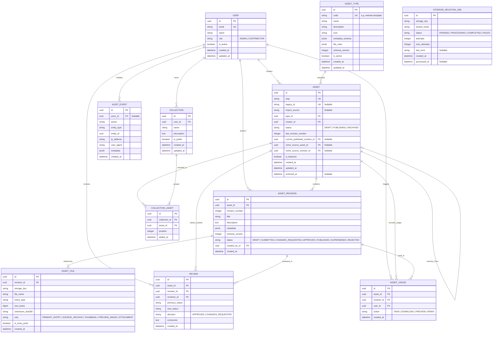

# sBLOOM Domain Model & Database Requirements (Prisma Readiness Final)

## 1. Executive Summary & Purpose
This document establishes the canonical domain specification, structural invariants, and database requirements for the **sBLOOM Template & Content Hub**. It incorporates all findings from Phase 3 Steps 1 & 2, resolves revision and lifecycle ownership boundaries, guarantees cross-asset revision integrity, specifies the legacy migration architecture for the verified 28 templates, and defines HTML preview isolation. This document serves as the binding blueprint for **Phase 3 Step 3: Prisma Schema Implementation**.

---

## 2. Domain Glossary
- **Asset**: The persistent logical container representing a creative resource (e.g., website template, social post). Its identity (`id` UUID, unique `slug`) remains permanent across all revisions and status transitions.
- **AssetType**: An extensible taxonomy entity classifying assets. Holds schema rules (`metadata_schema`), allowed file MIME types (`file_rules`), and icon/display configurations.
- **AssetRevision**: An immutable, versioned snapshot of an asset's content, metadata, and files at a specific moment in time. Identified by `(asset_id, revision_number)`.
- **Revision Number**: A strictly monotonic integer (`1, 2, 3...`) unique within an asset representing sequential evolution.
- **AssetFile**: A storage reference pointing to an immutable object in S3/Supabase Storage attached to an exact `AssetRevision`.
- **Review**: A domain-level record documenting a workflow transition, review decision, reviewer identity, and feedback notes for an exact `AssetRevision`.
- **AuditEvent**: An append-only, technical compliance log capturing security-relevant actions (actor, action, IP, timestamp, target) across the system.
- **Collection & CollectionAsset**: User-curated groupings of assets.
- **Authoritative User**: The backend record in the `users` table providing ground-truth account status (`is_active`) and role (`ADMIN`, `CONTRIBUTOR`), independent of client token claims.

---

## 3. Lifecycle Ownership Model: Asset vs. AssetRevision

### 3.1 The Dual-Status Lifecycle Architecture
To prevent the architectural defect where editing a published asset either takes the live asset offline or marks an unreviewed draft as published, status is explicitly divided between the container (`Asset`) and the snapshot (`AssetRevision`):

#### 1. `AssetRevision.status` (Content Workflow State)
Governs the review and editorial lifecycle of a specific revision:
- **`DRAFT`**: Being composed by the author. Mutable only if policy allows draft iteration.
- **`SUBMITTED`**: Submitted to the admin queue. Locked from author mutation.
- **`CHANGES_REQUESTED`**: Reviewer requested adjustments with feedback comments.
- **`APPROVED`**: Reviewer accepted this revision. Ready to be published.
- **`PUBLISHED`**: This exact revision is currently the active public representation of the asset.
- **`SUPERSEDED`**: A newer revision was published; this revision is now historical.
- **`REJECTED`**: Explicitly rejected or abandoned.

#### 2. `Asset.status` (Container Availability State)
Governs public discoverability and catalog presence:
- **`DRAFT`**: The asset has never had a published revision. Hidden from public discovery.
- **`PUBLISHED`**: The asset has an active published revision (`current_published_revision_id IS NOT NULL`). Publicly searchable.
- **`ARCHIVED`**: The asset is soft-deleted/retired (`archived_at IS NOT NULL`). Hidden from discovery.

### 3.2 State Machine & Transition Rules
```
AssetRevision Lifecycle:
   [ Create ]
       │
       ▼
    ┌────────┐      Submit (Contributor/Admin)      ┌───────────┐
    │ DRAFT  │ ───────────────────────────────────► │ SUBMITTED │
    └────────┘                                      └───────────┘
       ▲                                               │     │
       │                               Request         │     │ Approve
       │                               Changes         │     │ (Admin != Author)
       │                                  ┌────────────┘     ▼
       │                                  │             ┌──────────┐
       │                                  ▼             │ APPROVED │
       │                               ┌─────────┐      └──────────┘
       │            Rework into        │ CHANGES │           │
       └─────────── Revision N+1 ──────┤REQUESTED│           │ Publish (Admin/System)
                                       └─────────┘           ▼
                                                       ┌───────────┐
                                      Publish Newer ──►│ PUBLISHED │
                                       Revision        └───────────┘
                                                             │
                                                             ▼
                                                       ┌────────────┐
                                                       │ SUPERSEDED │
                                                       └────────────┘

Asset Container Lifecycle:
   [ DRAFT ] ──(Publish Revision 1)──► [ PUBLISHED ] ──(Archive)──► [ ARCHIVED ]
       ▲                                      │                          │
       │                                      │ (Restore)                │ (Restore)
       └──────────────────────────────────────┴──────────────────────────┘
```

### 3.3 Stale Approval and Race Prevention
- **Revision-Locked Reviews**: Every `Review` record targets an exact `revision_id`, NOT just an `asset_id`.
- **Decoupled Approvals**: If a contributor submits Revision 1, an admin can only review and approve Revision 1.
- If the contributor creates Revision 2 while Revision 1 is pending, Revision 1 remains the target of the pending review. Approving Revision 1 **only transitions Revision 1 to `APPROVED`**. It has zero effect on Revision 2.
- The `Publish` action requires an exact `revision_id` with `status = 'APPROVED'`. Passing Revision 2 when only Revision 1 was approved is rejected by the backend.
- Once Revision 2 is approved and published:
  - `Asset.current_published_revision_id` is updated to `revision_2.id`.
  - Revision 2 transitions to `PUBLISHED`.
  - Revision 1 transitions from `PUBLISHED` to `SUPERSEDED`.

---

## 4. Revision Integrity & Concurrency Architecture

### 4.1 Two-Phase Revision Editing & File Immutability
- **Unsubmitted Drafts**: While an `AssetRevision` remains in `DRAFT` and has never been submitted, authors may iteratively edit content (`title`, `description`, `metadata`, `schema_version`) and attach/detach `AssetFile` records in place.
- **Permanent Freeze upon Submission**: Once transitioned to `SUBMITTED`, content attributes and attached `AssetFile` sets are physically immutable.
- **Non-Reopenable Feedback**: A revision in `CHANGES_REQUESTED` is not reopened for editing; the author must create a new draft revision ($N+1$).
- **Identity & Provenance Invariance**: Identity columns (`id`, `asset_id`, `revision_number`, `created_by_id`, `created_at`) are immutable across all statuses, including `DRAFT`.
- **File Concurrency Serialization**: Any transaction modifying files executes `SELECT id, status FROM asset_revisions WHERE id = $1 FOR NO KEY UPDATE` and the database trigger queries `FOR SHARE`, preventing race conditions with simultaneous submission.

### 4.2 Concurrency Handling & Monotonic Revision-Number Allocation
To ensure strictly increasing revision numbers that are **never reused**, even if unsubmitted drafts are deleted:
1. **Container Atomic Counter**: The `Asset` entity tracks `last_revision_number` (`INT DEFAULT 0`).
2. **Transaction Boundary**:
   ```sql
   BEGIN;
   -- Increment container counter and lock the asset row
   UPDATE assets 
      SET last_revision_number = last_revision_number + 1 
    WHERE id = $1 
   RETURNING last_revision_number;

   INSERT INTO asset_revisions (asset_id, revision_number, title, metadata, created_by_id, status)
   VALUES ($1, $next_revision_number, $title, $metadata, $user_id, 'DRAFT');

   COMMIT;
   ```
3. **Guarantees**:
   - The PostgreSQL `UPDATE` statement acquires an exclusive row lock (`FOR UPDATE`) on the `assets` row, serializing concurrent creation attempts.
   - Deleting the highest-numbered unsubmitted draft does not decrement `assets.last_revision_number`; subsequent revisions continue monotonically, preventing revision number reuse.
   - Backstopped by the physical database constraint `UNIQUE (asset_id, revision_number)` on `AssetRevision`.

### 4.3 Cross-Asset Published-Revision Integrity (Relational Guard)
To prevent a bug or malicious update from pointing `Asset A.current_published_revision_id` to a revision belonging to `Asset B`:
1. `AssetRevision` enforces a composite unique constraint:
   `UNIQUE (id, asset_id)`
2. `Asset` enforces a composite foreign key constraint:
   `FOREIGN KEY (current_published_revision_id, id) REFERENCES asset_revisions(id, asset_id)`
3. **Mathematical Guarantee**: Because the composite key couples `(current_published_revision_id, id)` on `Asset` with `(id, asset_id)` on `AssetRevision`, PostgreSQL physically prohibits `current_published_revision_id` from referencing any revision whose `asset_id` does not match the asset's own `id`.

### 4.4 Remix Semantics and Provenance
- A Remix creates a new `Asset` record referencing:
  - `remix_source_asset_id` (FK to source `Asset.id`)
  - `remix_source_revision_id` (FK to source `AssetRevision.id`)
- Because the remix references an immutable `AssetRevision.id`, subsequent edits, deletions, or status changes on the source asset **cannot modify, break, or corrupt** the remix.

---

## 5. Extensibility Strategy: AssetType Registry & JSONB

### 5.1 Distinct Operational Levels
1. **Adding an asset of an existing type**: Standard contributor flow. Validated against pre-existing schema. No code or DDL changes.
2. **Adding a new asset type without code changes**: Admin inserts a row into `AssetType` with `metadata_schema` (JSON Schema) and `file_rules`. No migration or application code deployment required.
3. **Defining & validating type-specific metadata**: Stored in `AssetRevision.metadata` (JSONB) and validated against `AssetType.metadata_schema` at the API boundary.

### 5.2 Boundaries & Code Deployment Triggers
- JSONB alone does not provide dynamic forms or type safety. The schema definition in `AssetType` provides the contract.
- If a new asset type requires specialized server-side background processing (e.g. video transcoding, PDF parsing, automated headless screenshot generation), **worker application code must be deployed**. Standard file hosting and preview generation do not require code changes.

---

## 6. HTML and File Security Architecture

### 6.1 Safe Handling & Preview Isolation for `entryHtml`
Out of 28 legacy templates, **26 provide HTML/JS entry points** (`entryHtml`). These files contain arbitrary HTML, JavaScript, CSS, and external assets.

#### The Threat
Serving uploaded or legacy HTML files from the main application domain (`app.sbloom.internal`) enables catastrophic Cross-Site Scripting (XSS):
- Embedded scripts could access `localStorage` or session cookies.
- Scripts could make same-origin requests to the Next.js BFF and invoke backend endpoints.

#### The Security Architecture
1. **Dedicated Isolated Origin**:
   - Previews are served exclusively from an isolated sandbox domain: `https://preview.sbloom.internal` (or distinct origin).
   - This domain has **zero access to application session cookies, BFF JWTs, or internal API routes**.
2. **Iframe Sandboxing**:
   - The Hub frontend embeds previews using:
     ```html
     <iframe
       src="https://preview.sbloom.internal/assets/{asset_id}/r{revision_id}/preview"
       sandbox="allow-scripts allow-forms allow-popups"
       referrerpolicy="no-referrer"
       loading="lazy">
     </iframe>
     ```
   - Notice: `allow-same-origin` is omitted to prevent the iframe from accessing the parent frame or relaxing sandbox boundaries.
3. **Content Security Policy (CSP)**:
   - Preview server responses send:
     ```http
     Content-Security-Policy: default-src 'self' 'unsafe-inline' 'unsafe-eval' data: blob: https:; frame-ancestors https://app.sbloom.internal;
     X-Content-Type-Options: nosniff
     ```

### 6.2 File Storage & Ownership Integrity
- Files are modeled via `AssetFile`, linked to an immutable `revision_id`.
- Storage keys follow the deterministic path:
  `assets/{asset_id}/r{revision_number}/{file_uuid}_{sanitized_filename}`.
- S3 upload URLs are generated server-side as short-lived presigned PUT requests with strictly bound `Content-Type` and `Content-Length`.
- Files in object storage are write-once / immutable. Modifying files requires creating a new revision.

---

## 7. Legacy 28 Templates Migration Strategy

### 7.1 Verified Repository Evidence (`legacy/app.js`)
Inspection of `legacy/app.js` confirmed:
- **Total Count**: Exactly 28 curated templates.
- **Authors (5)**: Akbar (2), Disha (6), Poorvisha (7), Sathvika (7), Sravani (6).
- **Categories (3)**: Healthcare (9), Degree & College (11), School (8).
- **Types (3)**: Next.js (2), Vite (13), Static HTML (13).
- **Entry Points**: 26 templates have an explicit `entryHtml` path; 2 templates have `entryHtml: null` (both are Next.js apps).
- **Port Numbers**: 12 templates specify a local development port.
- **Featured**: 8 templates have `featured: true`.

### 7.2 Explicit Schema Columns for Legacy Tracking
To avoid fragile JSONB querying during migration and rollback, the `Asset` table includes explicit columns:
- **`Asset.legacy_id`**: `VARCHAR(100) UNIQUE NULL` — stores legacy identifier (e.g. `'akbar-htd-1'`). Indexed via unique B-tree index.
- **`Asset.import_source`**: `VARCHAR(50) NULL` — stores `'LEGACY_CATALOG'` for seed data.

### 7.3 Data Field Mapping
| Legacy Field | Target Entity & Column | Transformation / Logic |
|---|---|---|
| `id` | `Asset.slug` & `Asset.legacy_id` | Human-readable slug and unique legacy tracker. |
| `name` | `AssetRevision.title` | Direct string assignment. |
| `description` | `AssetRevision.description` | Direct text assignment. |
| `category` | `Asset.type_id` | Mapped to `AssetType` code (`website-template` or category taxonomy). |
| `author` | `Asset.creator_id` | Mapped to seeded placeholder `User` accounts (`akbar@sbloom.local`, etc.) with `CONTRIBUTOR` role. |
| `featured` | `Asset.is_featured` | Direct boolean assignment. |
| `stacks`, `version`, `icon`, `themeColor`, `accentGradient`, `features`, `port`, `folderPath`, `entryHtml`, `type` | `AssetRevision.metadata` (JSONB) | Preserved intact in revision metadata. |
| (Lifecycle) | `Asset.status` & `AssetRevision.status` | Initialized as `PUBLISHED`. |
| (Revision) | `AssetRevision.revision_number` | Initialized as `1`. |
| `folderPath` / `entryHtml` | `AssetFile` | Seeded with `role = 'PRIMARY_ENTRY'` pointing to legacy file roots. |

### 7.4 Migration Execution, Idempotency & Rollback
1. **Single ACID Transaction**: All 28 templates are ingested within one database transaction. Any schema violation or foreign key failure triggers an immediate `ROLLBACK`.
2. **Idempotency**: Ingestion uses `ON CONFLICT (legacy_id) DO UPDATE`. Re-running the script updates metadata without creating duplicate assets or revision rows.
3. **Atomic Rollback**:
   ```sql
   DELETE FROM assets WHERE import_source = 'LEGACY_CATALOG';
   ```
   Cascades through `asset_revisions`, `asset_files`, and `reviews`.

---

## 8. Authoritative Security & Role Permission Matrix

### 8.1 Backend Authoritative Role Resolution
- The Express backend extracts `sub` from the verified internal RS256 JWT.
- The backend queries the authoritative `User` table:
  ```sql
  SELECT id, role, is_active FROM users WHERE id = $1;
  ```
- If user does not exist or `is_active == false`, the request is rejected with `403 Forbidden`.
- Role claims in token headers or payloads are strictly ignored.

### 8.2 Permission Matrix
| Operation | Admin | Contributor (Author) | Contributor (Non-Author) |
|---|---|---|---|
| View Published Assets (Library / Details / Preview / Download) | ✅ | ✅ | ✅ |
| View Draft / Pending Revisions | ✅ | ✅ | ❌ |
| Create Asset / Draft Revision | ✅ | ✅ | ✅ |
| Edit Own Draft Revision | ✅ | ✅ (Draft/Changes Req.) | ❌ |
| Submit Revision for Review | ✅ | ✅ (Own Draft) | ❌ |
| Review & Decide Revision | ✅ (Not Author) | ❌ | ❌ |
| Direct Publish (Skip Review Queue) | ✅ | ❌ | ❌ |
| Archive / Unarchive Asset | ✅ | ✅ (Archive Own Only) | ❌ |
| Remix Published Asset | ✅ | ✅ | ✅ |
| Manage AssetTypes & Schemas | ✅ | ❌ | ❌ |
| View Security Audit Logs | ✅ | ❌ | ❌ |

---

## 9. Entity Relationship Diagram (Final)



---

## 10. Architectural Decisions Log & Product Defaults

### Confirmed Requirements & Architectural Decisions
- **Decision 008**: Extensibility via `AssetType` Registry + `JSONB` on `AssetRevision`.
- **Decision 009**: Immutable Revisions and Remix Lineage.
- **Decision 010**: Dual-status lifecycle model and revision-locked reviews.
- **Decision 011**: Authoritative backend role resolution querying `User` table.
- **Decision 012**: Segregation of domain `Review` vs technical `AuditEvent`.
- **Decision 013**: Idempotent legacy migration with explicit `legacy_id` and `import_source`.
- **Decision 014**: Admin Self-Approval Policy:
  - **Policy**: Admins are **forbidden** from approving their own submissions through the standard review queue (`Review.reviewer_id != AssetRevision.created_by_id`).
  - **Direct Publishing**: Authorized Admins may use the explicit, auditable `Direct Publish` action (`DRAFT` → `PUBLISHED`), logging an administrative review entry.
  - **Status**: Approved Default.
- **Decision 015**: Deferral of Dynamic UI Metadata Form Generator:
  - **Policy**: Dynamic frontend form generation from `AssetType.metadata_schema` is deferred to Phase 4. The Phase 3 data model supports the JSON Schema contracts immediately.
  - **Status**: Approved Default.
- **Decision 016**: HTML Preview Isolation Architecture:
  - **Policy**: Uploaded/legacy HTML previews must execute on an isolated sandbox domain with zero credentials and strict iframe CSP sandboxing.
  - **Status**: Approved Default.
- **Decision 017**: Monotonic Non-Reused Revision Counter:
  - **Policy**: Atomically increment `Asset.last_revision_number` on container row lock. Revision numbers are strictly increasing and never reused even if drafts are deleted.
  - **Status**: Approved Default.
- **Decision 018**: Dual-Key Administrative Purge & Transactional Storage Outbox:
  - **Policy**: Privileged stored procedure `admin_purge_asset` (`SECURITY DEFINER`) executes purge inside an ACID transaction, queuing physical file deletions in `StorageDeletionJob` outbox.
  - **Status**: Approved Default.
- **Decision 019**: Published-Pointer Consistency via Deferred Constraint Triggers:
  - **Policy**: PostgreSQL deferred constraint triggers evaluate published-pointer consistency at transaction `COMMIT` time, ensuring multi-statement publishing operations serialize cleanly without statement-order fragility.
  - **Status**: Approved Default.
- **Decision 020**: Review-Linkage Enforcement & Workflow Trust Boundary:
  - **Policy**: PostgreSQL deferred constraint trigger `trg_verify_review_linkage` requires an atomic `Review` record for any transition to `APPROVED`, `CHANGES_REQUESTED`, or `REJECTED`, backstopping the Express API authorization boundary.
  - **Status**: Approved Default.

---

## 11. Proposed Implementation Sequence (Phase 3)
1. **Step 1 (Complete)**: Domain Model & Database Requirements Discovery.
2. **Step 2 (Complete)**: Domain Model Review and Finalization.
3. **Step 3 (Next - Gate Cleared)**: Prisma Schema Definition (`packages/database/prisma/schema.prisma`).
4. **Step 4**: Migration Generation & Local Database Verification (PostgreSQL).
5. **Step 5**: Seed Script Implementation (AssetTypes, default Users, idempotent legacy 28 templates import).
6. **Step 6**: Backend Data Access Repositories (`packages/database`).
7. **Step 7**: Backend Asset CRUD & Lifecycle Endpoints with Authoritative Role Enforcement.
